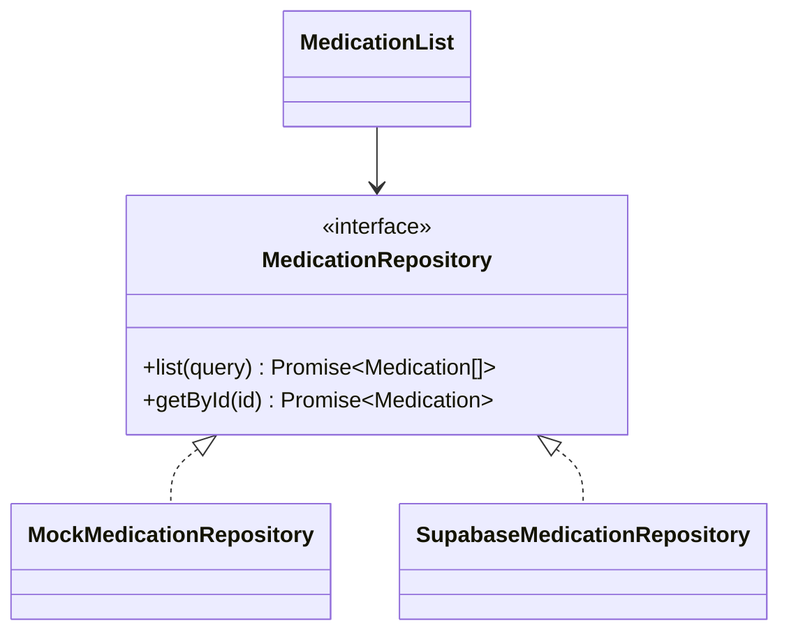

# ADR-003: Padrão Repository para acesso a dados

- **Status:** Aceita
- **Data:** 20/10/2026
- **Disciplinas relacionadas:** Modelagem de Padrões de Projetos, Projeto Integrador II

## Contexto

No código exportado do protótipo, cada tela declarava seus próprios dados fixos (por exemplo, a lista de medicamentos dentro do componente `MedicationList`). Isso acopla a interface à origem dos dados: para usar um banco real, seria necessário alterar todas as telas, e não seria possível testar a interface sem depender do banco.

## Decisão

Aplicar o padrão de projeto **Repository**:

- As **entidades** do domínio ficam em `src/app/domain` (ex.: `Medication`).
- Cada acesso a dados é descrito por uma **interface** em `src/app/repositories` (ex.: `MedicationRepository`, com `list` e `getById`).
- Existem **implementações** intercambiáveis: `MockMedicationRepository` (dados em memória) e, futuramente, uma implementação com Supabase.
- O arquivo `src/app/repositories/index.ts` é o **único ponto** onde se escolhe a implementação em uso.
- As telas dependem apenas da interface, nunca da implementação.

## Alternativas consideradas

| Alternativa | Por que não foi escolhida |
|---|---|
| Chamar o Supabase diretamente nas telas | Acoplamento forte, difícil de testar e de trocar de fornecedor |
| Gerenciador global de estado (Redux) como camada de dados | Resolve estado de interface, mas não separa a origem dos dados; excesso de complexidade para o prazo |

## Consequências

**Positivas**
- Desenvolvimento das telas antes de o banco estar pronto, usando o Mock.
- Testes automatizados sem rede nem banco.
- Troca de Mock por Supabase alterando uma única linha.
- Atende ao conteúdo de padrões de projeto da disciplina com uso real no código.

**Negativas / riscos**
- Mais arquivos e uma camada adicional de abstração.
- Exige disciplina para que nenhuma tela acesse o banco diretamente.

## Evidências

- Código em `src/app/domain` e `src/app/repositories`
- Diagrama de classes acima
- Print da tela de Medicamentos funcionando com o Mock
