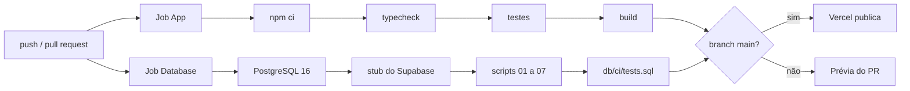

# ADR-006: Integração e entrega contínuas com GitHub Actions e Vercel

- **Status:** Aceita (CI implementada em 20/10/2026; CD pela Vercel desde o ADR-009)
- **Data:** 20/10/2026
- **Disciplinas relacionadas:** Integração e Entrega Contínua, Segurança e Defesa Cibernética

## Contexto

O código é versionado no GitHub por uma dupla. Para evitar que alterações quebrem o aplicativo ou as regras do banco, cada mudança precisa ser verificada automaticamente. O projeto tem duas partes que podem falhar de formas diferentes: o aplicativo (tipos, testes, build) e o banco de dados (esquema, segurança por linha e regras de negócio).

## Decisão

Criar o fluxo `.github/workflows/ci.yml`, executado a cada `push` e `pull request` na `main`, com **dois jobs independentes**:

1. **App:** `npm ci`, verificação de tipos (`npm run typecheck`), testes (`npm test`, que usam sempre os repositórios Mock), build de produção (`npm run build`) e guarda do resultado (`dist`) como artefato por 7 dias.
2. **Database:** sobe um PostgreSQL 16 como serviço, cria substitutos do Supabase (papéis `anon` e `authenticated` e esquema `auth`), aplica os scripts `db/01` a `db/07` em ordem e executa `db/ci/tests.sql`, que verifica RLS, regras do agendamento e validações dos lembretes. Qualquer verificação que falhe interrompe o job.

Demais decisões:
- Execuções antigas da mesma branch são canceladas quando chega um commit novo (`concurrency`), e o fluxo roda com permissão mínima (`contents: read`).
- Nenhuma chave do Supabase é usada no CI.
- **Entrega contínua (CD):** a Vercel publica automaticamente cada commit na `main` e cria uma prévia para cada Pull Request (ADR-009).
- Recomendado: proteger a `main` exigindo que os dois jobs passem antes do merge (Settings → Branches).

## Alternativas consideradas

| Alternativa | Por que não foi escolhida |
|---|---|
| GitLab CI ou Jenkins | O código já está no GitHub; Jenkins exige servidor próprio |
| Testar o banco só manualmente | Regras de segurança podem quebrar sem ninguém perceber |
| Usar o Supabase real no CI | Exigiria segredos no pipeline e dados reais em testes |
| Supabase CLI com contêineres no CI | Mais lento e complexo; os substitutos de `auth` bastam para o escopo |

## Consequências

**Positivas**
- Erros de tipo, testes quebrados e regras de banco violadas são pegos antes do merge.
- Os testes de banco documentam e protegem as regras de segurança do TCC.
- Evidência direta para a disciplina (pipeline com dois jobs).

**Negativas / riscos**
- O esquema de `auth` é simulado: não reproduz tudo do Supabase (por exemplo, o formato do token). Os casos principais foram escritos para depender só de `auth.uid()`.
- Manter `db/ci/tests.sql` em dia com novas regras exige disciplina.
- Plano gratuito do GitHub Actions tem limite mensal de minutos (suficiente para o projeto).

## Evidências

- `.github/workflows/ci.yml`, `db/ci/00_supabase_stub.sql`, `db/ci/tests.sql`
- Print do pipeline verde com os dois jobs; print de uma execução vermelha de demonstração
- Verificação por mutação registrada na ficha F11
