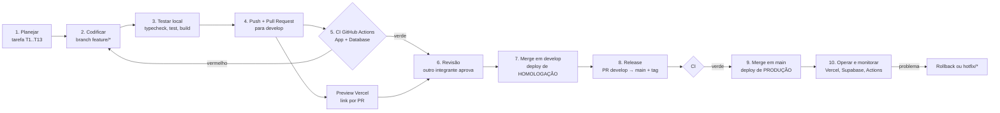
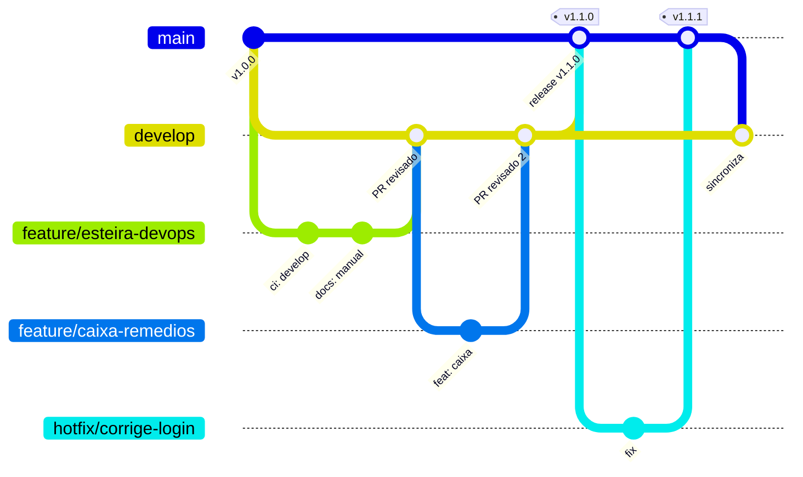
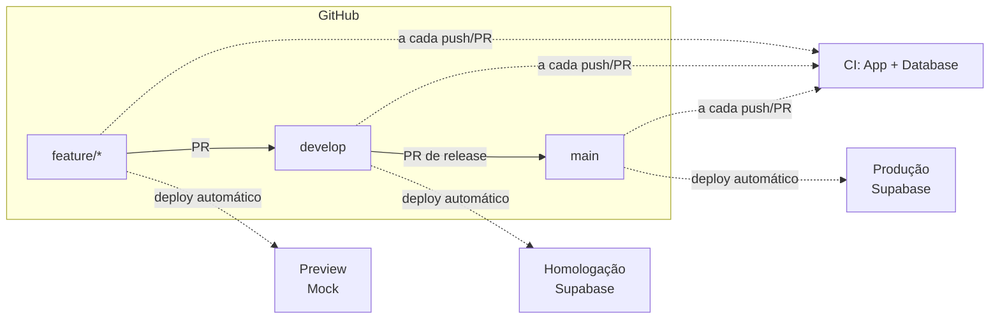

# Manual da esteira DevOps do InfoMed

> Disciplina: Programação Multiplataforma (e Integração e Entrega Contínua).
> Este manual descreve **como o código sai da máquina do desenvolvedor e chega ao celular do usuário**, com os comandos usados em cada etapa, as branches, os ambientes e quem faz o quê.

## Sumário

1. [Visão geral da esteira](#1-visão-geral-da-esteira)
2. [Ferramentas](#2-ferramentas)
3. [Branches](#3-branches)
4. [Ambientes](#4-ambientes)
5. [Manual de comandos por etapa](#5-manual-de-comandos-por-etapa)
6. [Deploy](#6-deploy)
7. [Rollback e hotfix](#7-rollback-e-hotfix)
8. [Configuração única (feita uma vez pelo dono do repositório)](#8-configuração-única-feita-uma-vez-pelo-dono-do-repositório)
9. [Papéis do grupo e registro de pull requests](#9-papéis-do-grupo-e-registro-de-pull-requests)
10. [Comandos usados na construção do projeto](#10-comandos-usados-na-construção-do-projeto)
11. [Evidências para a avaliação](#11-evidências-para-a-avaliação)

---

## 1. Visão geral da esteira



| Etapa DevOps | O que fazemos | Ferramenta |
|---|---|---|
| Plan | Fila de tarefas T1 a T13, ADRs e fichas | `docs/PROGRESSO.md`, `docs/decisions/`, GitHub |
| Code | Uma branch por tarefa | Git, VS Code |
| Build | Build de produção do PWA | Vite (`npm run build`) |
| Test | Tipos, 104 testes de app, testes do banco | TypeScript, Vitest, PostgreSQL + `db/ci/tests.sql` |
| Release | Pull request `develop → main` e tag de versão | GitHub, `git tag` |
| Deploy | Automático a cada merge | Vercel (front), SQL Editor (banco) |
| Operate | App no ar, banco gerenciado | Vercel, Supabase |
| Monitor | Status dos deploys, logs, pipeline | Painel da Vercel, Supabase, aba Actions |

---

## 2. Ferramentas

| Ferramenta | Papel na esteira | Arquivo de configuração |
|---|---|---|
| **Git + GitHub** | Versionamento, branches, pull requests, revisão | `.gitignore`, `.github/pull_request_template.md` |
| **GitHub Actions** | Integração contínua (CI): 2 jobs a cada push e PR | `.github/workflows/ci.yml` |
| **Vercel** | Entrega contínua (CD): build e deploy automáticos, um link por PR | `vercel.json` |
| **Supabase** | Banco PostgreSQL, autenticação, API | `db/*.sql` |
| **Node.js 22 + npm** | Instalar, rodar, testar e gerar o build | `package.json`, `package-lock.json` |
| **Vitest** | Testes automatizados | `vitest.config.ts` |
| **Vite + vite-plugin-pwa** | Build do app instalável | `vite.config.ts` |

---

## 3. Branches

Usamos um **Git Flow simplificado**: duas branches permanentes e branches curtas por tarefa.



| Branch | Vida | Para que serve | Quem pode enviar | Deploy |
|---|---|---|---|---|
| `main` | Permanente | Código em **produção** | Só por pull request aprovado vindo de `develop` ou `hotfix/*` | Produção |
| `develop` | Permanente | **Homologação**: junta as tarefas prontas antes de liberar | Só por pull request aprovado vindo de `feature/*`, `fix/*`, `docs/*` | Homologação |
| `feature/<nome>` | Curta | Uma funcionalidade (ex.: `feature/caixa-remedios`) | Quem está desenvolvendo | Preview |
| `fix/<nome>` | Curta | Correção que pode esperar a próxima versão | Quem corrige | Preview |
| `docs/<nome>` | Curta | Só documentação | Quem documenta | Preview |
| `hotfix/<nome>` | Curta | Correção **urgente** em produção; sai de `main` e volta para `main` e `develop` | Quem corrige | Preview → Produção |

**Regras:**
- Ninguém faz `push` direto em `main` nem em `develop` (proteção configurada no GitHub, seção 8).
- Todo pull request precisa de **CI verde** e **1 aprovação de outro integrante** (quem abriu não pode aprovar o próprio PR).
- Nome de branch em minúsculas, com hífen, sem acento: `feature/painel-bi`.
- Mensagens de commit no padrão *Conventional Commits*: `feat:`, `fix:`, `docs:`, `chore:`, `test:`, `refactor:`.
- Versões com *SemVer*: `vMAIOR.MENOR.CORREÇÃO` (ex.: `v1.1.0` = funcionalidades novas, `v1.1.1` = correção).

---

## 4. Ambientes

| Ambiente | De onde vem | Endereço | Banco de dados | Para quê |
|---|---|---|---|---|
| **Local** | Máquina do desenvolvedor (`npm run dev`) | `http://localhost:5173` | **Mock** (sem `.env`) ou Supabase (com `.env`) | Desenvolver |
| **CI** | GitHub Actions, a cada push/PR | — (só testes) | PostgreSQL 16 temporário, apagado ao final | Garantir que nada quebrou |
| **Preview** | Vercel, um por branch/PR | Link gerado no PR (ex.: `infomed-git-feature-x-....vercel.app`) | **Mock** (sem variáveis do Supabase) | Revisor testar a tarefa sem mexer em dados reais |
| **Homologação** | Vercel, branch `develop` | Domínio fixo da branch `develop` (ver seção 8) | Supabase | Testar o conjunto antes de liberar |
| **Produção** | Vercel, branch `main` | Link público do app | Supabase | Usuários, banca e pesquisa SUS |



**Como o app sabe em qual modo está:** `src/app/repositories/index.ts` usa o Supabase **somente se** as variáveis `VITE_SUPABASE_URL` e `VITE_SUPABASE_PUBLISHABLE_KEY` existirem. Na Vercel elas são cadastradas para *Production* e só para a branch `develop` em *Preview*. As outras previews ficam sem elas e rodam em Mock.

**Limitação (declarar no trabalho):** existe **um único projeto Supabase**, usado por homologação e produção. O ideal seria um segundo projeto Supabase só para homologação (o plano gratuito permite 2 projetos). Mudanças no banco são feitas por **scripts numerados** (`db/01` a `db/09`), testados antes no CI.

---

## 5. Manual de comandos por etapa

Todos os comandos rodam no terminal do VS Code, dentro da pasta do projeto (`C:\projetos\InfoMed`).

### Etapa 0 — Preparar a máquina (uma vez)

```bash
node -v                      # precisa ser 22 ou maior
git --version
git config --global user.name "Seu Nome"
git config --global user.email "email-da-sua-conta-github"
git clone https://github.com/balbino-z/infomed-tcc.git InfoMed
cd InfoMed
npm ci                       # instala exatamente as versões do package-lock.json
```

### Etapa 1 — Começar uma tarefa

```bash
git checkout develop         # vai para a branch de homologação
git pull origin develop      # traz o que os colegas já integraram
git checkout -b feature/nome-da-tarefa
```

### Etapa 2 — Desenvolver e testar localmente

```bash
npm run dev                  # app em http://localhost:5173 (Ctrl + C para parar)
npm run typecheck            # checa os tipos (TypeScript)
npm test                     # 104 testes automatizados
npm run build                # gera o build de produção em dist/
npm run preview              # serve o build localmente para conferir
```

Se mexeu no banco: criar `db/NN_nome.sql` (próximo número), atualizar `db/ci/tests.sql` e incluir o arquivo na lista do `ci.yml`.

### Etapa 3 — Registrar o trabalho (commit)

```bash
git status                   # o que mudou
git diff                     # ver as mudanças linha a linha
git add caminho/do/arquivo   # ou: git add -A
git commit -m "feat: descreve o que a mudança faz"
```

### Etapa 4 — Enviar e abrir o pull request

```bash
git push -u origin feature/nome-da-tarefa
```

Depois, no GitHub: aparece o botão **Compare & pull request** → base: `develop` ← compare: `feature/nome-da-tarefa` → preencher o modelo (já vem pronto) → em *Reviewers*, escolher o colega → **Create pull request**.

Pela linha de comando (opcional, com o GitHub CLI instalado):

```bash
gh pr create --base develop --title "feat: nome da tarefa" --fill --reviewer usuario-do-colega
```

### Etapa 5 — Integração contínua (automática)

O GitHub Actions roda sozinho os dois jobs no PR:

| Job | Passos |
|---|---|
| **App** | `npm ci` → `npm run typecheck` → `npm test` → `npm run build` → guarda o `dist` |
| **Database** | PostgreSQL 16 → `db/ci/00_supabase_stub.sql` → `db/01` a `db/09` → `db/ci/tests.sql` → carga e remoção dos dados de demonstração |

Se ficar vermelho: abrir o job na aba **Actions**, ler o erro, corrigir na mesma branch e dar `git push` de novo. O PR atualiza sozinho.

Para rodar a esteira manualmente: aba **Actions** → **CI** → **Run workflow**.

### Etapa 6 — Revisão (feita por outro integrante)

1. Abrir o PR → aba **Files changed** → ler as mudanças e comentar linha a linha se precisar.
2. Abrir o **link de Preview** que a Vercel comenta no PR e testar seguindo o "Como testar".
3. Conferir o checklist do revisor no PR.
4. **Review changes** → **Approve** (ou **Request changes** com o motivo).

Para testar a branch do colega na própria máquina:

```bash
git fetch origin
git checkout feature/nome-da-tarefa
npm ci
npm test
npm run dev
```

### Etapa 7 — Integrar em homologação

No PR aprovado e com CI verde: **Squash and merge** → **Delete branch**. A Vercel publica `develop` em homologação sozinha.

```bash
git checkout develop
git pull origin develop
git branch -d feature/nome-da-tarefa       # apaga a branch local
```

### Etapa 8 — Liberar uma versão (release)

1. No GitHub: **New pull request** → base: `main` ← compare: `develop` → título `release: v1.1.0`.
2. CI verde + aprovação do colega → **Create a merge commit** (não usar squash aqui, para manter o histórico de `develop`).
3. Marcar a versão:

```bash
git checkout main
git pull origin main
git tag -a v1.1.0 -m "v1.1.0: esteira DevOps e caixa de remédios"
git push origin v1.1.0
```

4. No GitHub: **Releases** → **Draft a new release** → escolher a tag → **Generate release notes** → **Publish**.

### Etapa 9 — Banco de dados em produção

Os scripts SQL não rodam sozinhos na nuvem: o dono do repositório roda cada script novo **depois do merge em `main`**, no Supabase → **SQL Editor** → colar o conteúdo → **Run**, na ordem numérica. Antes, o mesmo script já passou pelo job **Database** do CI.

---

## 6. Deploy

O deploy é **contínuo e automático**: a Vercel está ligada ao repositório do GitHub.

| Evento no GitHub | O que a Vercel faz |
|---|---|
| Push em qualquer branch / PR aberto | Gera um deploy de **Preview** e comenta o link no PR |
| Merge em `develop` | Atualiza **Homologação** |
| Merge em `main` | Atualiza **Produção** |

Em cada deploy a Vercel executa: `npm ci` (instala) → `npm run build` (gera `dist/`) → publica o `dist/` na CDN. O `vercel.json` faz todas as rotas (`/postos/123`, `/perfil`...) abrirem o `index.html`, o que é necessário num app de página única (SPA).

**Deploy manual pela linha de comando** (alternativa, se a integração com o GitHub falhar):

```bash
npx vercel login
npx vercel link                 # liga a pasta ao projeto da Vercel (uma vez)
npx vercel                      # deploy de preview
npx vercel --prod               # deploy de produção
```

**Conferir um deploy (smoke test, 2 minutos):**
1. Abrir o link → a tela de boas-vindas carrega.
2. Entrar com uma conta de teste → Início mostra o nome.
3. Postos → lista e mapa carregam.
4. Recarregar a página em `/postos` (F5) → continua funcionando.
5. Celular: o app pode ser instalado (menu → Instalar app).

---

## 7. Rollback e hotfix

**Desfazer um deploy ruim (rápido, sem código):** Vercel → **Deployments** → escolher o último deploy bom → **⋯** → **Promote to Production** (ou **Instant Rollback**). O app volta em segundos.

**Desfazer pelo Git (deixa registrado):**

```bash
git checkout -b fix/reverte-mudanca develop
git revert <hash-do-commit>
git push -u origin fix/reverte-mudanca
# abrir PR para develop e seguir a esteira normal
```

**Hotfix (erro grave em produção):**

```bash
git checkout main
git pull origin main
git checkout -b hotfix/descricao-curta
# corrigir, testar
npm run typecheck && npm test && npm run build
git commit -am "fix: descreve a correção"
git push -u origin hotfix/descricao-curta
# PR para main → revisão → merge → tag v1.1.1
# depois, PR de main para develop (ou merge local) para develop não perder a correção:
git checkout develop
git pull origin develop
git merge main
git push origin develop
```

---

## 8. Configuração única (feita uma vez pelo dono do repositório)

### GitHub: proteger as branches
**Settings → Rules → Rulesets → New branch ruleset**, um para `main` e outro para `develop`:
- *Enforcement status:* **Active**
- *Target branches:* `main` (e outro ruleset para `develop`)
- ✅ **Restrict deletions**
- ✅ **Require a pull request before merging** → *Required approvals:* **1** → ✅ *Dismiss stale approvals when new commits are pushed*
- ✅ **Require status checks to pass** → adicionar `App (types, tests, build)` e `Database (schema, RLS and rules)`
- ✅ **Block force pushes**

**Settings → General → Pull Requests:** deixar *Allow squash merging* e *Allow merge commits* ligados; ligar *Automatically delete head branches*.

**Settings → Collaborators:** adicionar cada integrante com permissão **Write**.

> Observação: em repositório **privado** de conta gratuita, o GitHub pode não aplicar as regras de proteção. Nesse caso, deixar o repositório **público** (não há segredos nele: a chave `publishable` do Supabase é pública por natureza e o `.env` não é versionado) ou combinar no grupo e mostrar a regra configurada no print.

### Vercel: branches e ambientes
1. **Settings → Git → Production Branch:** `main`.
2. **Settings → Environment Variables:**
   - `VITE_SUPABASE_URL` e `VITE_SUPABASE_PUBLISHABLE_KEY` com escopo **Production**.
   - As mesmas duas com escopo **Preview** e **Branch: `develop`** (só homologação usa o banco).
   - Nada para as outras previews → elas rodam em Mock.
3. **Settings → Domains → Add:** um domínio para homologação (ex.: `infomed-hml.vercel.app`, se estiver livre) → em *Git Branch*, escolher `develop`.
4. **Settings → Deployment Protection:** se as previews pedirem login da Vercel, desligar *Vercel Authentication* para *Preview* ou adicionar os colegas no time, para os revisores conseguirem abrir o link.

### Supabase: liberar os endereços dos ambientes
**Authentication → URL Configuration → Redirect URLs:** adicionar o domínio de produção, o de homologação e `http://localhost:5173`.

---

## 9. Papéis do grupo e registro de pull requests

> **Preencher com os nomes reais.** O GitHub registra autor, revisor e data de cada PR: os prints da aba *Pull requests* comprovam esta tabela.

### Papéis na esteira

| Integrante | Usuário GitHub | Papel na esteira | Atividades |
|---|---|---|---|
| (nome) | `balbino-z` | Dono do repositório e desenvolvedor | Configurou GitHub Actions, Vercel, Supabase e as regras de branch; desenvolveu as tarefas de código; abriu PRs; revisou os PRs de documentação; fez as releases e tags; rodou os SQL em produção |
| (nome) | (usuário) | Documentação e revisor | Escreveu a documentação do TCC em branches `docs/*`; **revisou e aprovou os PRs de código** testando o link de Preview |
| (nome) | (usuário) | (preencher) | (preencher) |

### Registro de pull requests

| PR | Branch → destino | Tarefa | Desenvolveu | Abriu o PR | Revisou e aprovou | Data | Resultado |
|---|---|---|---|---|---|---|---|
| #1 | `feature/esteira-devops` → `develop` | Esteira DevOps (CI em develop, modelo de PR, manual) | (nome) | (nome) | (nome do colega) | | |
| #2 | `develop` → `main` | Release v1.1.0 | — | (nome) | (nome do colega) | | |
| | | | | | | | |

### Histórico antes da esteira (declarar com transparência)

Até 18/11/2026 todos os commits (19) foram feitos pela conta do dono do repositório, direto na `main`, protegidos só pelo CI; o outro integrante trabalhava na documentação fora do Git. A partir da versão `v1.1.0` todo o trabalho passa pelo fluxo branch → pull request → revisão → merge descrito aqui. O histórico de commits anterior continua visível em `git log` e mostra a evolução por tarefa (T0 a T12).

---

## 10. Comandos usados na construção do projeto

Comandos reais que aparecem no histórico do projeto (`docs/PROGRESSO.md` e `git log`), por fase:

| Fase | Comandos |
|---|---|
| Criar o repositório | `git init`, `git add -A`, `git commit -m "chore: importa projeto do Figma Make"`, `git remote add origin https://github.com/balbino-z/infomed-tcc.git`, `git push -u origin main` |
| Limpar o export do Figma | `node fix-imports.mjs` |
| Dependências | `npm install`, `npm install -D vite-plugin-pwa`, `npm install leaflet@1.9.4 react-leaflet@4.2.1`, `npm i -D @types/leaflet`, `npm pkg set scripts.typecheck="tsc --noEmit"` |
| Corrigir versionamento | `git rm -r --cached node_modules`, `git rm --cached "docs/senha supabase.md"` |
| Dados das UBS | `node scripts/geocode-unidades.mjs`, `node scripts/gerar-sql-unidades.mjs` |
| IA (triagem) | `node scripts/treinar-triagem.mjs` |
| Diagramas | `node scripts/gerar-diagramas.mjs` |
| Qualidade (antes de cada commit) | `npm run typecheck`, `npm test`, `npm run build` |
| Esteira | `git checkout -b develop`, `git push -u origin develop`, `git checkout -b feature/esteira-devops`, `git push -u origin feature/esteira-devops` |
| Envio | `git push origin main` |

---

## 11. Evidências para a avaliação

Salvar em `docs/evidence/devops/`:

| Print | Onde |
|---|---|
| Branches `main`, `develop` e `feature/*` | GitHub → **Branches** |
| Regras de proteção de `main` e `develop` | GitHub → Settings → Rules |
| Um PR aberto com o modelo preenchido, revisor, CI verde e link de Preview | GitHub → Pull requests → o PR |
| A aprovação do revisor | Aba *Conversation* do PR ("approved these changes") |
| Lista de PRs fechados (autor e revisor) | GitHub → Pull requests → **Closed** |
| Pipeline verde e um vermelho | GitHub → Actions |
| Deploys de Preview, Homologação e Produção | Vercel → Deployments (filtrar por branch) |
| Variáveis por ambiente | Vercel → Settings → Environment Variables (**esconder os valores**) |
| Tag e release | GitHub → Releases |
| Terminal com os comandos da etapa 2 | VS Code |
| Rollback (opcional) | Vercel → Deployments → Promote to Production |
