<!-- CAPA -->
[NOME DA INSTITUIÇÃO DE ENSINO]
CURSO SUPERIOR DE TECNOLOGIA EM ANÁLISE E DESENVOLVIMENTO DE SISTEMAS (PROGRAMA AMS)
Vinícius Balbino
Pablo Furtado Casagrande
ESTEIRA DEVOPS DO SISTEMA INFOMED:
integração contínua, revisão por pull request e entrega contínua
[CIDADE]
2026

<!-- FOLHA DE ROSTO -->
Relatório técnico apresentado à disciplina de Programação Multiplataforma do Curso Superior de Tecnologia em Análise e Desenvolvimento de Sistemas, como parte do Trabalho de Conclusão de Curso (Projeto Integrador II).
Professor(a): [NOME DO(A) PROFESSOR(A)]

<!-- FIM DOS ELEMENTOS PRÉ-TEXTUAIS DE IDENTIFICAÇÃO -->

# RESUMO

Este relatório documenta a esteira DevOps adotada no InfoMed, aplicativo web progressivo (PWA) de saúde pública desenvolvido como Trabalho de Conclusão de Curso. A esteira organiza o caminho do código desde a máquina do desenvolvedor até o usuário final em três ambientes: homologação, produção e uma pré-visualização (*preview*) para cada pull request. O versionamento segue um Git Flow simplificado, com as branches permanentes `main` (produção) e `develop` (homologação) protegidas por regras que exigem pull request, aprovação de outro integrante e integração contínua aprovada. A integração contínua, no GitHub Actions, executa verificação de tipos, 120 testes automatizados, o build de produção e 52 verificações de segurança do banco de dados a cada alteração. A entrega contínua é feita pela Vercel, que publica automaticamente cada branch no ambiente correspondente. O relatório apresenta os comandos utilizados em cada etapa, a organização das branches e dos ambientes, a execução real da esteira em três rodadas de revisão cruzada e uma release versionada (v1.1.0), e registra, com evidências, o que cada integrante desenvolveu, quais pull requests abriu e quais revisou.

**Palavras-chave:** DevOps; integração contínua; entrega contínua; Git; pull request.

# SUMÁRIO

[SUMÁRIO]

# 1 INTRODUÇÃO

DevOps é o conjunto de práticas que aproxima o desenvolvimento (*Development*) da operação (*Operations*) de software, automatizando o caminho entre uma alteração no código e sua disponibilização ao usuário, com qualidade verificada a cada passo (KIM et al., 2016). O núcleo técnico dessa abordagem é a esteira (*pipeline*) de integração e entrega contínuas: cada alteração é integrada ao código principal com frequência, testada automaticamente e publicada por um processo repetível (HUMBLE; FARLEY, 2010).

No InfoMed, a esteira foi construída para atender a três objetivos: garantir que nenhuma alteração chegue à produção sem testes automatizados aprovados; garantir que toda alteração seja revisada por outro integrante antes de ser integrada; e permitir que o deploy seja feito sem intervenção manual, com possibilidade de retorno rápido à versão anterior.

## 1.1 Objetivos

a) documentar a esteira DevOps do projeto e as ferramentas que a compõem;
b) apresentar um manual com os comandos utilizados em cada etapa;
c) explicar a organização das branches e dos ambientes;
d) demonstrar a execução real da esteira, com evidências;
e) registrar a atividade de cada integrante: quem desenvolveu, quem abriu os pull requests e quem os revisou e aprovou.

## 1.2 Ferramentas

Quadro 1 – Ferramentas da esteira

| Ferramenta | Papel na esteira |
|---|---|
| Git | Controle de versão local: branches, commits e tags |
| GitHub | Repositório remoto, pull requests, revisão de código e regras de proteção das branches |
| GitHub Actions | Integração contínua: verificação de tipos, testes, build e testes do banco a cada alteração |
| Vercel | Entrega contínua: build e publicação automática de cada branch no ambiente correspondente |
| Supabase | Banco de dados PostgreSQL e autenticação na nuvem |
| Node.js 22 e npm | Instalação de dependências, execução local, testes e build |
| Vitest | Testes automatizados da aplicação |
| Playwright CLI | Captura das telas usadas como evidência |
| VS Code | Editor e terminal |

Fonte: elaborado pelos autores (2026).

Os integrantes utilizaram assistentes de inteligência artificial (Claude Code) como apoio na escrita de documentação, na execução de comandos e na captura de telas, sempre sob supervisão e com revisão humana nos pull requests, conforme as regras registradas no arquivo `CONTEXTO-IA.md` do repositório.

# 2 VISÃO GERAL DA ESTEIRA

A Figura 1 apresenta o fluxo completo. O desenvolvedor trabalha numa branch própria da tarefa e envia as alterações ao GitHub. Ao abrir um pull request, o GitHub Actions executa dois jobs em paralelo e a Vercel publica uma pré-visualização. Somente com os dois jobs aprovados e a revisão de outro integrante o GitHub libera a integração (*merge*). A integração na `develop` atualiza a homologação; uma release da `develop` para a `main` atualiza a produção.

Figura 1 – Fluxo da esteira DevOps do InfoMed
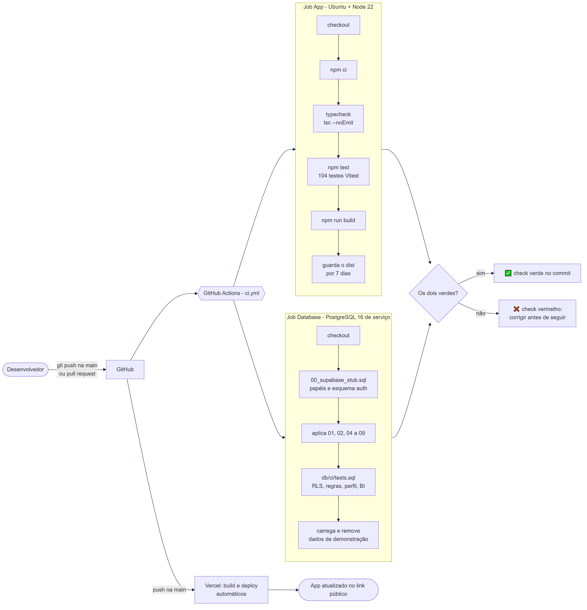
Fonte: elaborado pelos autores (2026).

Quadro 2 – Etapas DevOps e sua realização no projeto

| Etapa DevOps | Como é feita no InfoMed | Ferramenta |
|---|---|---|
| Planejar | Tarefas numeradas, decisões em ADRs e fichas de funcionalidade | GitHub, `docs/` |
| Codificar | Uma branch por tarefa, criada a partir da `develop` | Git, VS Code |
| Construir | Build de produção do PWA | Vite (`npm run build`) |
| Testar | Tipos, 120 testes de aplicação e 52 verificações do banco | TypeScript, Vitest, PostgreSQL |
| Revisar | Pull request com aprovação obrigatória de outro integrante | GitHub |
| Liberar | Pull request `develop → main`, tag e Release versionada | GitHub, `git tag` |
| Implantar | Publicação automática a cada merge | Vercel |
| Operar e monitorar | Painel de deploys, logs e histórico da integração contínua | Vercel, GitHub Actions |

Fonte: elaborado pelos autores (2026).

# 3 ORGANIZAÇÃO DAS BRANCHES

O projeto adota um Git Flow simplificado (DRIESSEN, 2010), com duas branches permanentes e branches curtas por tarefa. A Figura 2 ilustra o modelo.

Figura 2 – Modelo de branches (ilustrativo)
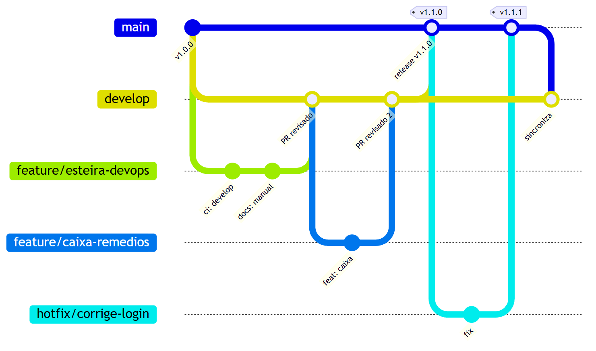
Fonte: elaborado pelos autores (2026).

Quadro 3 – Branches do projeto

| Branch | Duração | Função | Como recebe alterações | Ambiente |
|---|---|---|---|---|
| `main` | Permanente | Código em produção | Somente por pull request aprovado vindo da `develop` (release) ou de `hotfix/*` | Produção |
| `develop` | Permanente | Homologação: integra as tarefas prontas | Somente por pull request aprovado vindo das branches de tarefa | Homologação |
| `feature/<nome>` | Curta | Nova funcionalidade | Commits de quem desenvolve | Preview |
| `fix/<nome>` | Curta | Correção | Commits de quem corrige | Preview |
| `docs/<nome>` | Curta | Documentação | Commits de quem documenta | Preview |
| `test/<nome>` | Curta | Demonstração ou experimento, sem merge | Commits de quem testa | Preview |
| `hotfix/<nome>` | Curta | Correção urgente, sai da `main` | Commits de quem corrige | Preview → Produção |

Fonte: elaborado pelos autores (2026).

As mensagens de commit seguem o padrão *Conventional Commits* (`feat:`, `fix:`, `docs:`, `test:`, `chore:`), e as versões seguem o versionamento semântico (SEMVER, 2013): `v1.1.0` indica funcionalidades novas compatíveis e `v1.1.1` indica correções ou documentação.

## 3.1 Regras de proteção

As branches `main` e `develop` são protegidas por regras do GitHub (*rulesets*), sem exceção nem mesmo para o dono do repositório. As regras exigem: pull request antes do merge; uma aprovação de outro integrante, invalidada se houver novo commit depois dela; aprovação dos jobs App e Database da integração contínua; e proíbem *force push* e a exclusão da branch (Figuras 3 e 4).

Figura 3 – Regras de proteção ativas para `main` e `develop`
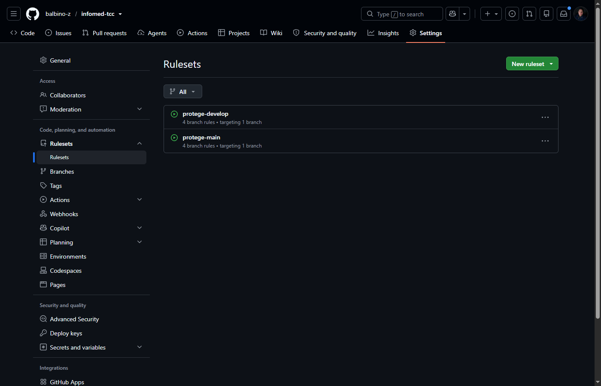
Fonte: GitHub, capturado pelos autores (2026).

Figura 4 – Detalhe da regra da `main`: uma aprovação e os dois jobs do CI obrigatórios
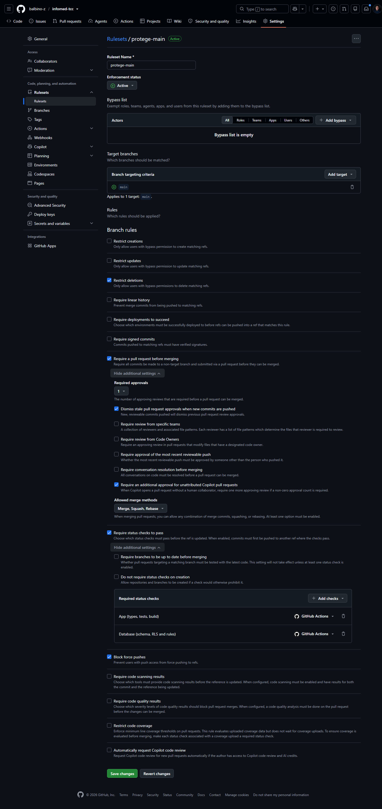
Fonte: GitHub, capturado pelos autores (2026).

# 4 AMBIENTES

O projeto possui cinco ambientes, apresentados no Quadro 4 e na Figura 5.

Quadro 4 – Ambientes

| Ambiente | Origem | Endereço | Dados | Finalidade |
|---|---|---|---|---|
| Local | `npm run dev` na máquina do integrante | `http://localhost:5173` | Simulados (Mock) ou Supabase | Desenvolver |
| Integração contínua | GitHub Actions, a cada push e pull request | — | PostgreSQL 16 temporário, apagado ao final | Testar automaticamente |
| Preview | Vercel, um por pull request | Link comentado no pull request | Simulados (Mock) | Revisor testar a tarefa |
| Homologação | Vercel, branch `develop` | https://infomed-tcc-git-develop-vinicius-balbinos-projects.vercel.app | Supabase | Testar o conjunto antes da release |
| Produção | Vercel, branch `main` | https://infomed-tcc.vercel.app | Supabase | Usuários e banca |

Fonte: elaborado pelos autores (2026).

Figura 5 – Relação entre branches e ambientes
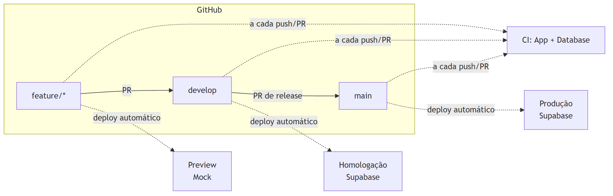
Fonte: elaborado pelos autores (2026).

A separação entre previews (dados simulados) e homologação/produção (banco real) é feita pelas variáveis de ambiente da Vercel: as variáveis do Supabase existem apenas para *Production* e para a *Preview* da branch `develop` (Figura 6). As demais previews são construídas sem elas e o aplicativo entra automaticamente no modo simulado, sem acesso a dados reais.

Figura 6 – Variáveis de ambiente por ambiente na Vercel (valores ocultos)
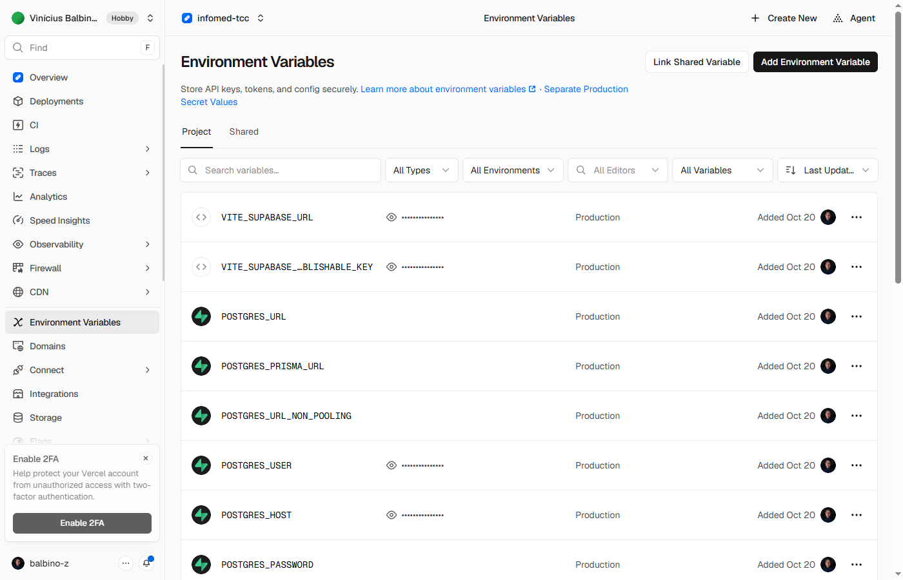
Fonte: Vercel, capturado pelos autores (2026).

Figura 7 – Deploys na Vercel: produção (`main`) e previews (`develop` e branches de tarefa)
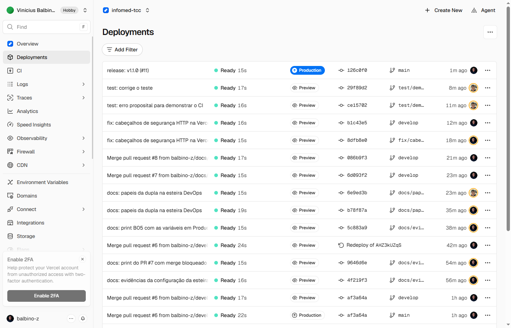
Fonte: Vercel, capturado pelos autores (2026).

# 5 MANUAL DE COMANDOS

Os comandos abaixo foram executados no terminal do VS Code (PowerShell), na pasta do projeto. O manual completo, com explicações e solução de problemas, está em `docs/devops/MANUAL-DEVOPS.md` e `docs/devops/PASSO-A-PASSO-DUPLA.md`.

Quadro 5 – Comandos por etapa da esteira

| Etapa | Comandos | Para que serve |
|---|---|---|
| Preparar a máquina | `git config --global user.name "Nome"` · `git config --global user.email "email"` | Identificar o autor dos commits |
| Baixar o projeto | `git clone https://github.com/balbino-z/infomed-tcc.git InfoMed` · `cd InfoMed` · `npm ci` | Copiar o repositório e instalar as dependências exatas |
| Iniciar uma tarefa | `git checkout develop` · `git pull origin develop` · `git checkout -b docs/papeis-do-grupo` | Partir da homologação atualizada numa branch nova |
| Desenvolver | `npm run dev` | Executar o app em `localhost:5173` |
| Testar localmente | `npm run typecheck` · `npm test` · `npm run build` | Verificar tipos, rodar os testes e gerar o build |
| Registrar | `git status` · `git add <arquivo>` · `git commit -m "docs: descrição"` | Ver, selecionar e salvar as alterações |
| Enviar | `git push -u origin <branch>` | Publicar a branch no GitHub |
| Abrir o pull request | GitHub: *Compare & pull request*, base `develop` (ou `gh pr create --base develop --reviewer <colega>`) | Pedir revisão |
| Atualizar a máquina após o merge | `git checkout develop` · `git pull origin develop` · `git branch -D <branch>` | Sincronizar e limpar |
| Corrigir o autor de um commit | `git commit --amend --reset-author --no-edit` · `git push --force-with-lease` | Refazer o último commit com o e-mail correto (só em branch de tarefa) |
| Release | GitHub: pull request `develop → main`, *Create a merge commit* | Levar a homologação à produção |
| Versionar | `git checkout main` · `git pull origin main` · `git tag -a v1.1.0 -m "..."` · `git push origin v1.1.0` · `gh release create v1.1.0 --generate-notes` | Marcar e publicar a versão |
| Retornar à versão anterior | Vercel: *Deployments* → *Promote to Production* no deploy anterior, ou `git revert <commit>` numa branch `fix/*` | Desfazer um deploy com problema |

Fonte: elaborado pelos autores (2026).

# 6 INSTRUÇÕES DE DEPLOY

O deploy é contínuo e automático: a Vercel está conectada ao repositório do GitHub e reage a cada envio.

Quadro 6 – Eventos e deploys

| Evento no GitHub | O que a Vercel faz |
|---|---|
| Push em uma branch de tarefa ou abertura de pull request | Gera um deploy de Preview e comenta o link no pull request |
| Merge na `develop` | Atualiza a Homologação |
| Merge na `main` | Atualiza a Produção |

Fonte: elaborado pelos autores (2026).

Em cada deploy a Vercel executa `npm install`, `npm run build` e publica a pasta `dist/` em sua rede de distribuição. O arquivo `vercel.json` redireciona todas as rotas para o `index.html` (necessário em aplicações de página única) e, a partir da versão v1.1.0, envia cabeçalhos de segurança HTTP. Mudanças no banco de dados são feitas por scripts numerados (`db/NN_*.sql`), testados antes pelo job Database e aplicados pelo dono do repositório no SQL Editor do Supabase depois do merge.

Para verificar um deploy, a equipe abre o endereço do ambiente e confere a tela inicial, o login, a lista de postos com o mapa e a recarga da página numa rota interna (`/postos`). Em caso de problema, o deploy anterior é promovido novamente à produção pela própria Vercel, em segundos.

# 7 EXECUÇÃO DA ESTEIRA

Esta seção mostra a esteira em funcionamento real, em 21/11/2026, em três rodadas de revisão cruzada e uma release.

## 7.1 Configuração inicial (Balbino)

O dono do repositório adicionou o colega como colaborador (Figura 8), sincronizou a `develop` com a `main`, criou as regras de proteção (Figuras 3 e 4), configurou os ambientes e variáveis na Vercel (Figuras 6 e 7) e liberou os endereços de homologação e preview na autenticação do Supabase (Figura 9). As evidências dessa configuração foram enviadas no PR #7, revisado e aprovado pelo Pablo (Figura 10).

Figura 8 – Colaboradores do repositório
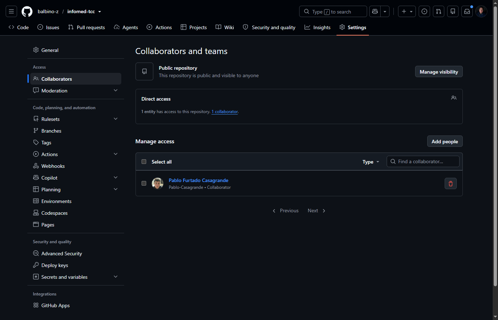
Fonte: GitHub, capturado pelos autores (2026).

Figura 9 – URLs de redirecionamento liberadas no Supabase
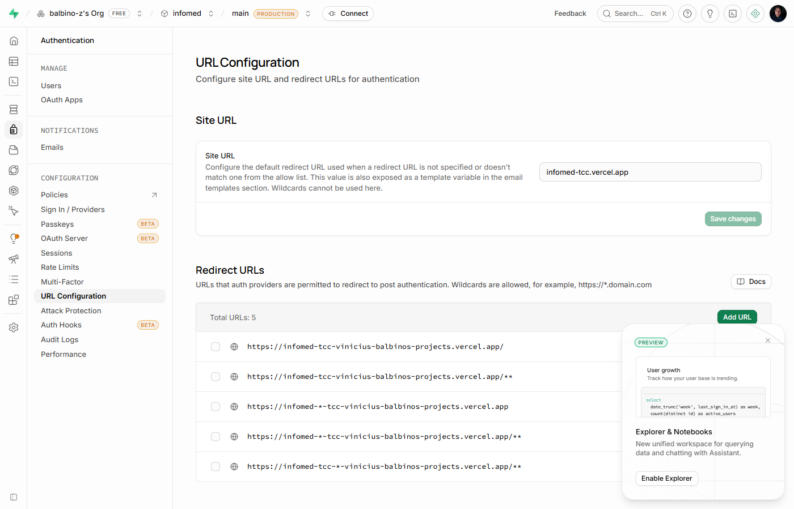
Fonte: Supabase, capturado pelos autores (2026).

Figura 10 – Aprovação do PR #7 pelo Pablo
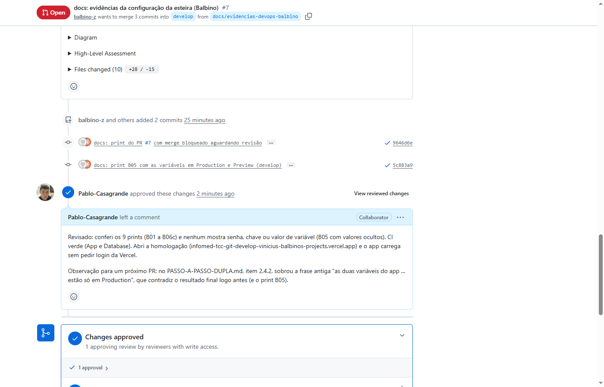
Fonte: GitHub, capturado pelos autores (2026).

## 7.2 Rodada 1: Pablo desenvolve, Balbino revisa (PR #8)

O Pablo preparou o ambiente local (Figura 11), criou a branch `docs/papeis-do-grupo`, preencheu a tabela de papéis do manual, executou os testes e enviou as alterações (Figura 12). Ao abrir o pull request para a `develop`, o GitHub bloqueou o merge até a revisão (Figura 13). O Balbino revisou as alterações e aprovou; o merge foi então realizado (Figura 14).

Durante a rodada, o commit não aparecia vinculado à conta do Pablo, porque o e-mail configurado no Git tinha um caractere invisível copiado junto. O problema foi corrigido configurando o e-mail novamente e refazendo o commit (`git commit --amend --reset-author` e `git push --force-with-lease`), o que vinculou o commit à conta correta (Figura 15).

Figura 11 – Aplicação executando localmente (`npm run dev`)

Fonte: capturado pelos autores (2026).

Figura 12 – Comandos `git add`, `git commit` e `git push` da Rodada 1
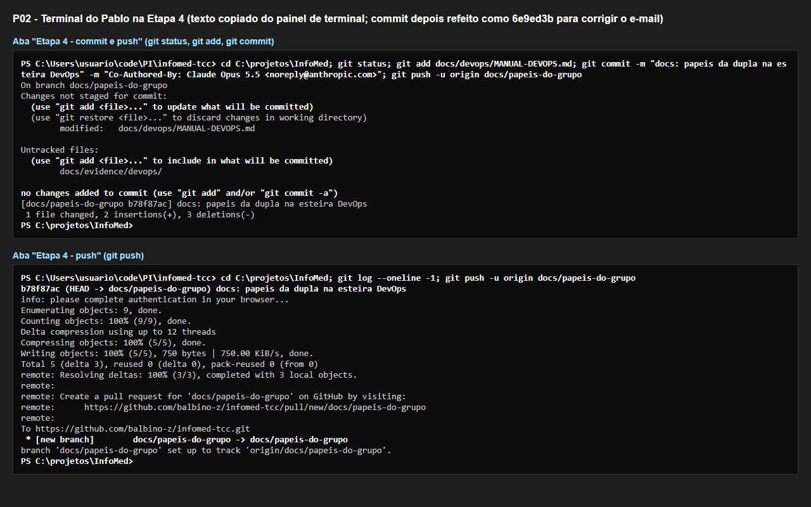
Fonte: capturado pelos autores (2026).

Figura 13 – PR #8 com o merge bloqueado aguardando revisão
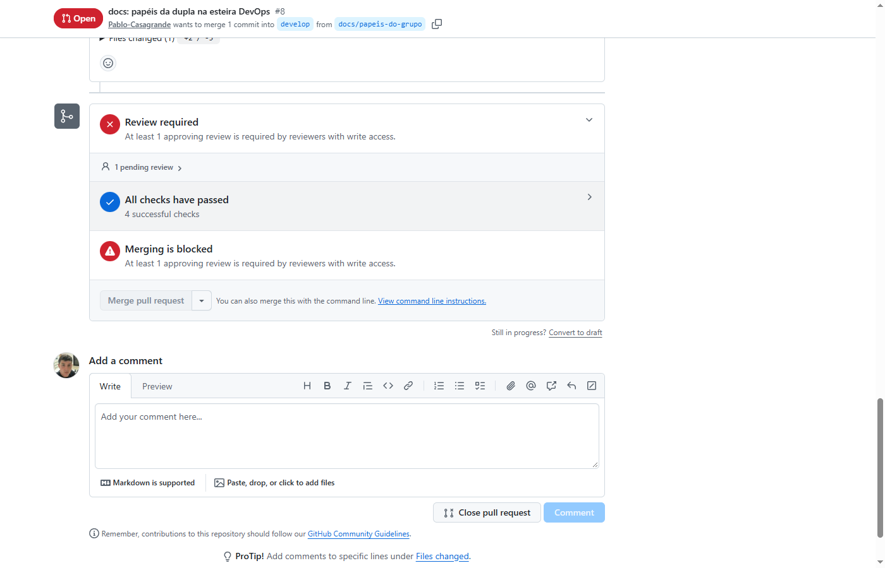
Fonte: GitHub, capturado pelos autores (2026).

Figura 14 – PR #8 aprovado pelo Balbino e integrado à `develop`
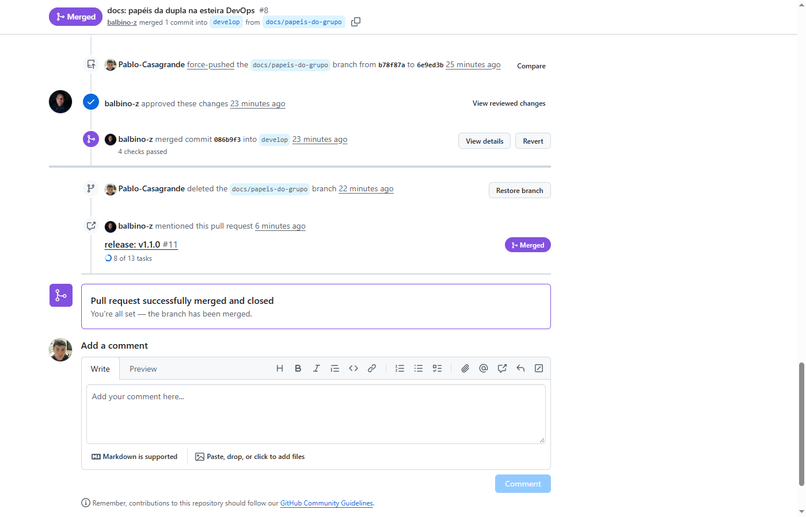
Fonte: GitHub, capturado pelos autores (2026).

Figura 15 – Commit do PR #8 vinculado à conta do Pablo após a correção do e-mail
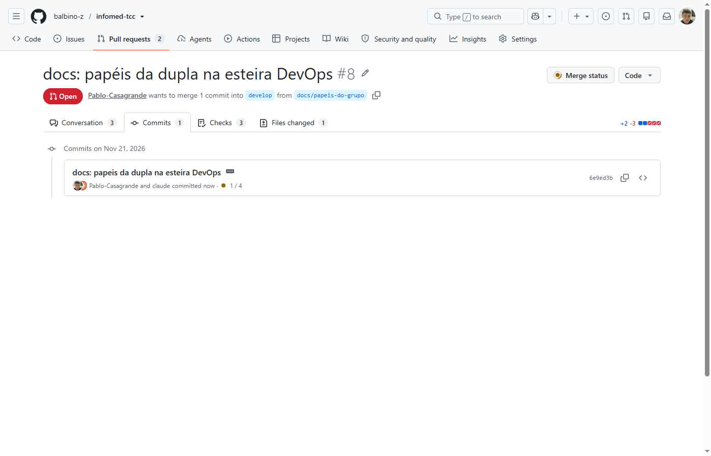
Fonte: GitHub, capturado pelos autores (2026).

## 7.3 Rodada 2: Balbino desenvolve, Pablo revisa (PR #9)

O Balbino implementou uma correção real apontada no Relatório de Segurança do projeto (achado V04): cabeçalhos de segurança HTTP no `vercel.json`. Após os testes locais, abriu o PR #9 para a `develop` com o Pablo como revisor (Figura 16). O Pablo abriu o link de Preview, conferiu no navegador que os cabeçalhos estavam presentes (Figura 17) e aprovou (Figura 18).

Figura 16 – PR #9 aberto pelo Balbino, com o Pablo como revisor
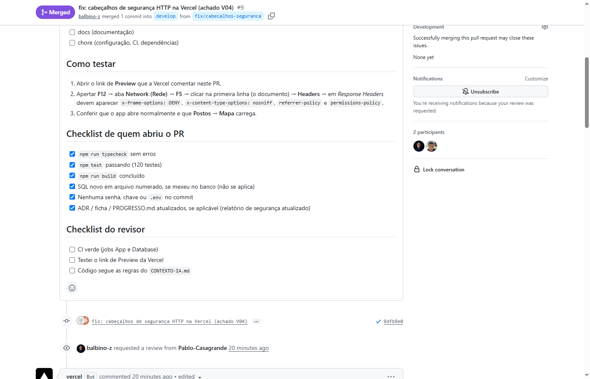
Fonte: GitHub, capturado pelos autores (2026).

Figura 17 – Cabeçalhos de segurança conferidos na Preview do PR #9
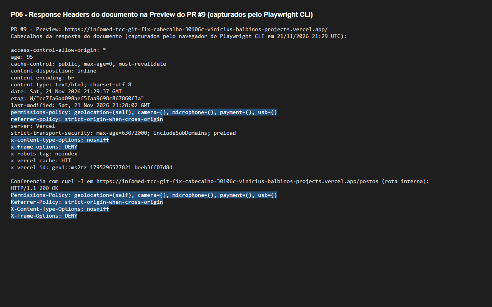
Fonte: capturado pelos autores (2026).

Figura 18 – Aprovação do PR #9 pelo Pablo
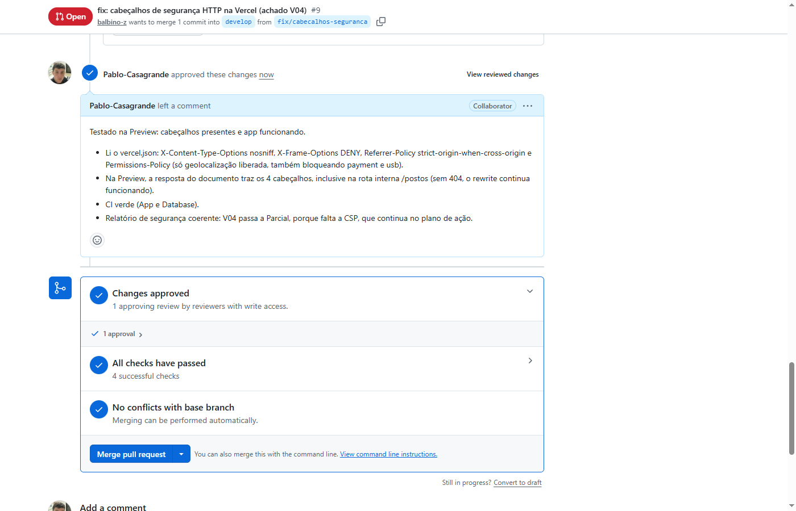
Fonte: GitHub, capturado pelos autores (2026).

## 7.4 Rodada 3: a integração contínua barrando um erro (PR #10)

Para demonstrar que a esteira impede a integração de código defeituoso, o Pablo alterou propositalmente o resultado esperado de um teste e abriu o PR #10. O job App falhou e o merge foi bloqueado (Figuras 19 e 20). Após desfazer a alteração, os jobs voltaram a ser aprovados (Figura 21). Como a branch não continha mudança útil, o pull request foi fechado sem merge.

Figura 19 – PR #10 com o job App reprovado e o merge bloqueado
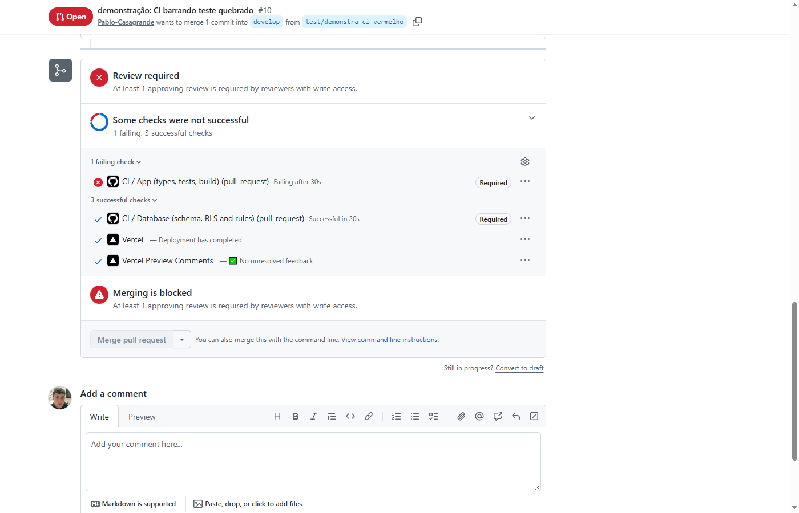
Fonte: GitHub, capturado pelos autores (2026).

Figura 20 – Registro do teste que falhou no GitHub Actions
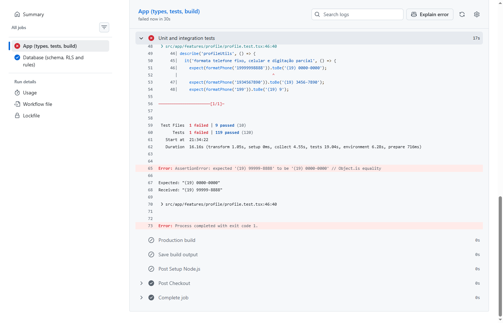
Fonte: GitHub Actions, capturado pelos autores (2026).

Figura 21 – Jobs aprovados novamente após a correção
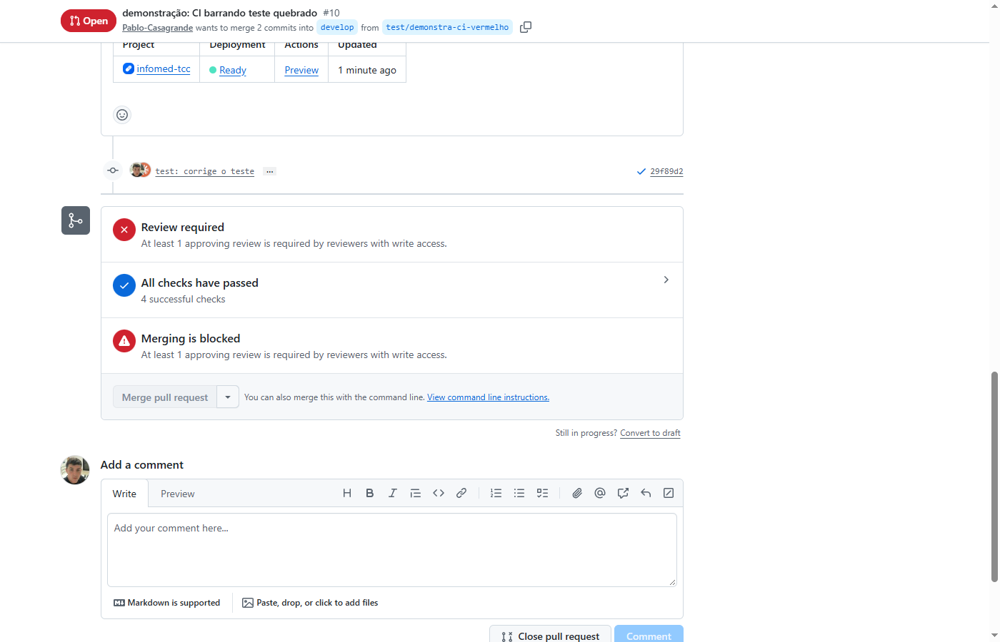
Fonte: GitHub, capturado pelos autores (2026).

## 7.5 Release v1.1.0 (PR #11)

Com as rodadas integradas, os dois integrantes testaram a homologação (Figura 22). O Balbino abriu o pull request de release da `develop` para a `main`, que o Pablo aprovou (Figura 23). O merge foi feito com *merge commit*, preservando o histórico da `develop`, e a versão foi marcada com a tag `v1.1.0` (Figura 24) e publicada como Release no GitHub (Figura 25). A Vercel publicou a produção automaticamente (Figura 7), que foi conferida no endereço público (Figura 26).

Figura 22 – Homologação aberta para teste antes da release
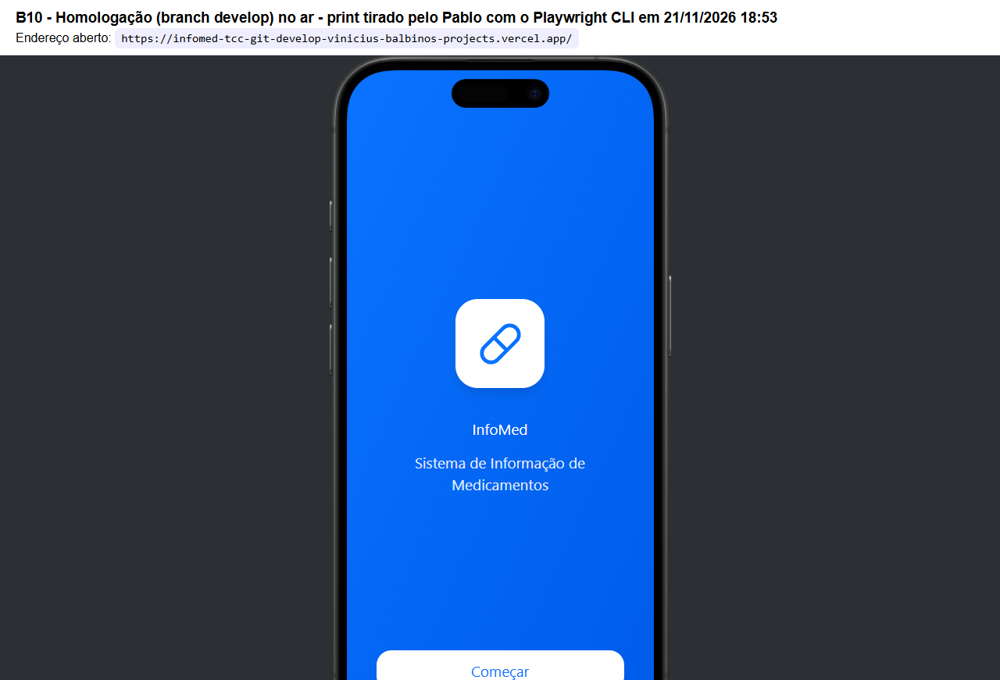
Fonte: capturado pelos autores (2026).

Figura 23 – Aprovação do pull request de release pelo Pablo
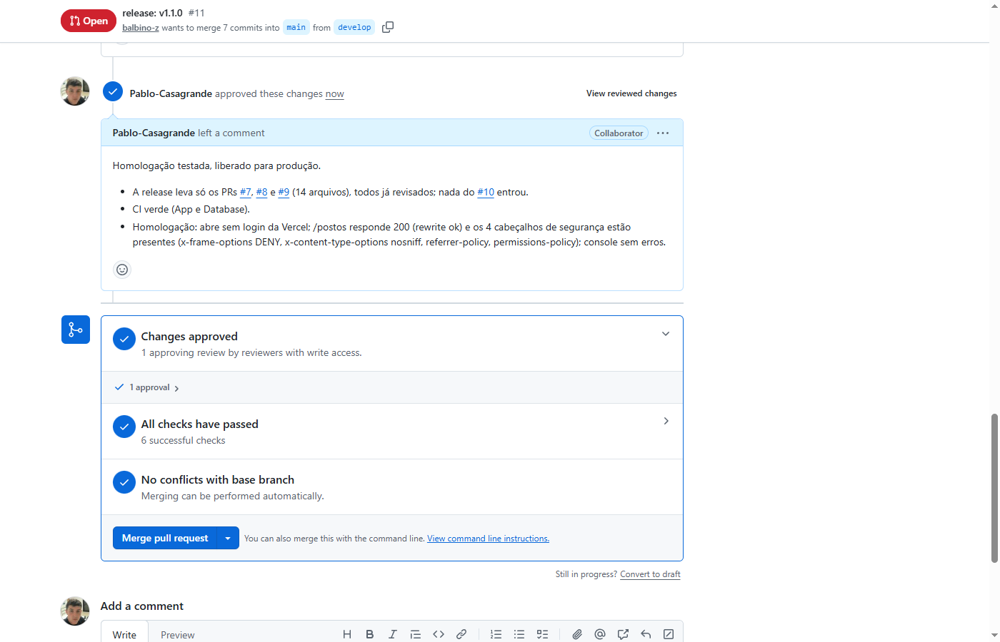
Fonte: GitHub, capturado pelos autores (2026).

Figura 24 – Comandos de criação e envio da tag `v1.1.0`
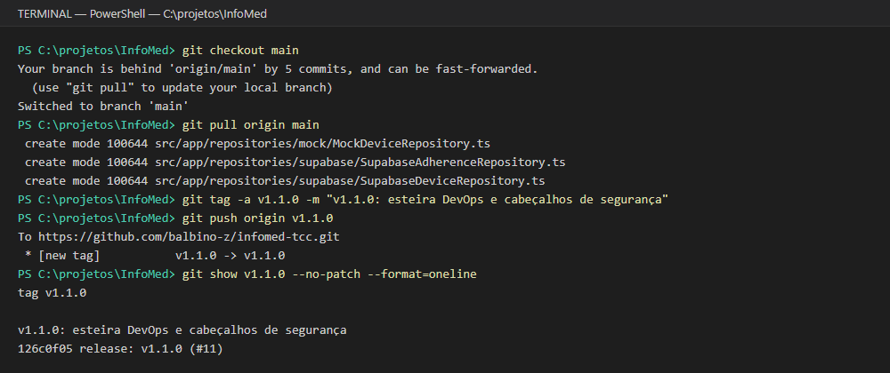
Fonte: capturado pelos autores (2026).

Figura 25 – Release v1.1.0 publicada no GitHub
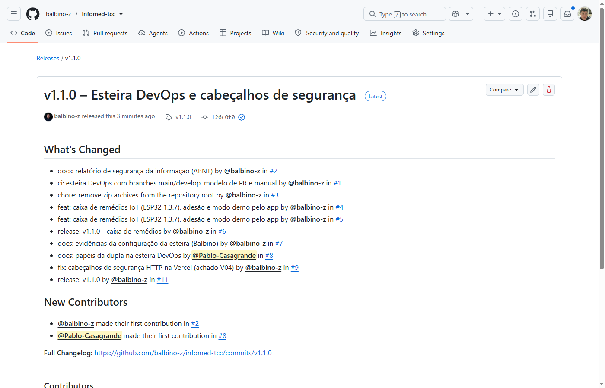
Fonte: GitHub, capturado pelos autores (2026).

Figura 26 – Produção no ar após a release
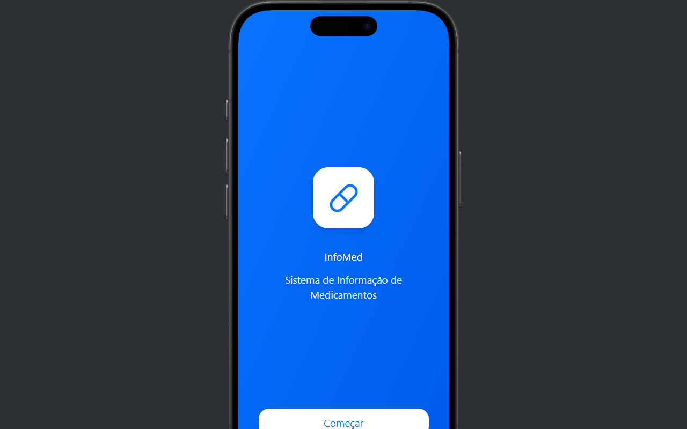
Fonte: capturado pelos autores (2026).

## 7.6 Registro das evidências (PRs #12 e #13)

O Pablo reuniu as evidências em `docs/evidence/devops/`, preencheu o registro de pull requests no manual e o diário do projeto (`docs/PROGRESSO.md`), em dois pull requests revisados e aprovados pelo Balbino. Este relatório foi integrado pelo pull request seguinte e levado à produção na release v1.1.1.

# 8 ATIVIDADES DE CADA INTEGRANTE

## 8.1 Papéis

Quadro 7 – Papéis e atividades na esteira

| Integrante | Usuário GitHub | Papel | Atividades na esteira |
|---|---|---|---|
| Vinícius Balbino | `balbino-z` | Dono do repositório e desenvolvedor | Configurou o GitHub Actions, as regras de proteção, a Vercel e o Supabase; desenvolveu o código da aplicação e a correção dos cabeçalhos de segurança; abriu os PRs #7, #9 e #11; revisou e aprovou os PRs #8, #12 e #13 do Pablo; realizou os merges, a release, a tag `v1.1.0` e a conferência da produção |
| Pablo Furtado Casagrande | `Pablo-Casagrande` | Revisor e documentação | Desenvolveu as tarefas de documentação e a demonstração do CI; abriu os PRs #8, #10, #12 e #13; revisou e aprovou os PRs #7, #9 e #11 do Balbino, testando a Preview e a homologação; registrou as evidências e o diário do projeto |

Fonte: elaborado pelos autores (2026).

## 8.2 Registro de pull requests

O Quadro 8 registra, para cada pull request da esteira, quem desenvolveu, quem abriu, quem revisou e aprovou e quem realizou o merge, conforme o histórico do GitHub.

Quadro 8 – Registro de pull requests

| PR | Branch → destino | Tarefa | Desenvolveu | Abriu | Revisou e aprovou | Merge | Resultado |
|---|---|---|---|---|---|---|---|
| #7 | `docs/evidencias-devops-balbino` → `develop` | Evidências da configuração da esteira | Balbino | Balbino | Pablo | Balbino | Integrado |
| #8 | `docs/papeis-do-grupo` → `develop` | Papéis da dupla (Rodada 1) | Pablo | Pablo | Balbino | Balbino | Integrado |
| #9 | `fix/cabecalhos-seguranca` → `develop` | Cabeçalhos de segurança HTTP (Rodada 2) | Balbino | Balbino | Pablo | Balbino | Integrado |
| #10 | `test/demonstra-ci-vermelho` → `develop` | Demonstração do CI (Rodada 3) | Pablo | Pablo | — | — | Fechado sem merge (CI barrou) |
| #11 | `develop` → `main` | Release v1.1.0 | — | Balbino | Pablo | Balbino | Integrado, tag `v1.1.0` |
| #12 | `docs/evidencias-devops` → `develop` | Evidências e registro | Pablo | Pablo | Balbino | Balbino | Integrado |
| #13 | `docs/evidencias-finais` → `develop` | Evidências finais | Pablo | Pablo | Balbino | Balbino | Integrado |

Fonte: elaborado pelos autores a partir do histórico do GitHub (2026).

Os PRs #1 a #6, anteriores à configuração das regras de proteção, foram abertos e integrados pela conta do dono do repositório sem revisão humana e estão registrados no manual como "antes da esteira".

# 9 DIFICULDADES E LIÇÕES APRENDIDAS

a) **Pull requests sem revisão antes das regras:** os primeiros PRs foram integrados pela mesma pessoa que os abriu. A lição foi configurar as regras de proteção antes de começar o fluxo; a partir delas, o GitHub passou a impedir esse caminho.
b) **Autor do commit não reconhecido:** um caractere invisível no e-mail do Git impediu o GitHub de associar o commit à conta do integrante. A verificação da aba *Commits* do pull request passou a fazer parte da revisão.
c) **Variáveis de ambiente substituídas:** ao editar uma variável na Vercel para incluir a homologação, o ambiente de produção foi removido da variável em vez de mantido. O problema foi detectado antes da release, comparando o build publicado, e corrigido criando uma entrada para cada ambiente.
d) **Redeploy necessário:** variáveis de ambiente só passam a valer em um build novo; a homologação precisou ser republicada após a mudança.
e) **Proteção de acesso às previews:** a autenticação da Vercel impedia o revisor de abrir os links de preview; ela foi desativada, sem risco aos dados, pois as previews usam dados simulados.
f) **Erro real detectado pelo CI:** antes da esteira completa, a integração contínua já havia barrado um caractere digitado por engano num script SQL, o que mostrou o valor dos testes automáticos do banco.

# 10 CONSIDERAÇÕES FINAIS

A esteira implementada cumpre os objetivos propostos: nenhuma alteração chega às branches de homologação ou produção sem testes automatizados aprovados e sem revisão de outro integrante, e o deploy acontece automaticamente, com retorno rápido em caso de problema. A execução real das três rodadas e da release mostrou o fluxo funcionando nos dois sentidos de revisão e a integração contínua bloqueando um erro proposital.

Como trabalhos futuros, sugerem-se: um projeto Supabase separado para a homologação, a política de segurança de conteúdo (CSP) pendente no relatório de segurança e a automação dos scripts de banco de dados na própria esteira.

# REFERÊNCIAS

DRIESSEN, Vincent. **A successful Git branching model**. [S. l.], 2010. Disponível em: https://nvie.com/posts/a-successful-git-branching-model/. Acesso em: 21 nov. 2026.

GITHUB. **About rulesets**. [S. l.], 2026. Disponível em: https://docs.github.com/en/repositories/configuring-branches-and-merges-in-your-repository/managing-rulesets/about-rulesets. Acesso em: 21 nov. 2026.

HUMBLE, Jez; FARLEY, David. **Continuous delivery**: reliable software releases through build, test, and deployment automation. Upper Saddle River: Addison-Wesley, 2010.

KIM, Gene et al. **The DevOps handbook**: how to create world-class agility, reliability, and security in technology organizations. Portland: IT Revolution Press, 2016.

SEMVER. **Semantic Versioning 2.0.0**. [S. l.], 2013. Disponível em: https://semver.org/. Acesso em: 21 nov. 2026.

VERCEL. **Environments**. [S. l.], 2026. Disponível em: https://vercel.com/docs/deployments/environments. Acesso em: 21 nov. 2026.

# APÊNDICE A – RELAÇÃO COMPLETA DAS EVIDÊNCIAS

Todas as evidências estão em `docs/evidence/devops/` no repositório. O prefixo B indica capturas da parte do Balbino; o prefixo P, da parte do Pablo.

Quadro 9 – Evidências da esteira

| Arquivo | Conteúdo |
|---|---|
| B01-colaboradores.png | Colaboradores do repositório |
| B02-rulesets.png | Regras de proteção ativas |
| B03-ruleset-main.png | Regra da `main` |
| B03b-ruleset-main-detalhes.png | Regra da `main` com aprovação e checks obrigatórios |
| B04-vercel-ambientes.png | Ambientes da Vercel (produção acompanhando a `main`) |
| B05-vercel-variaveis.png | Variáveis por ambiente, valores ocultos |
| B06-vercel-deployments.png | Deploys de produção e preview antes da esteira completa |
| B06b-supabase-redirect-urls.png | URLs liberadas no Supabase |
| B06c-pr7-merge-bloqueado.png | PR #7 com merge bloqueado aguardando revisão |
| B07-files-changed.png | Revisão das alterações do PR #8 |
| B08-aprovacao.png | Aprovação e merge do PR #8 |
| B09-pr-balbino.png | PR #9 aberto com o revisor |
| B10-homologacao.png | Homologação aberta |
| B11-terminal-tag.png | Tag `v1.1.0` consultada no terminal do Pablo |
| B11b-terminal-tag-balbino.png | Criação e envio da tag `v1.1.0` no terminal do Balbino |
| B12-release.png | Release v1.1.0 no GitHub |
| B13-vercel-deployments.png | Status de deploy por branch registrados no GitHub |
| B13b-vercel-deployments-tela.png | Tela de deploys da Vercel após a release |
| B14-producao-no-ar.png | Produção após a release |
| P01-npm-run-dev.png e P01-npm-run-dev-terminal.txt | Aplicação executando localmente |
| P02-comandos-commit-push.png | Comandos da Rodada 1 |
| P03-pr-aberto.png | PR #8 aberto |
| P04-merge-bloqueado.png | PR #8 bloqueado aguardando revisão |
| P04b-pr8-commit-do-pablo.png | Commit vinculado à conta do Pablo |
| P05-pr-mesclado.png e P05b-pr8-aprovado-e-mesclado.png | PR #8 integrado |
| P06-cabecalhos-na-preview.png e P06-cabecalhos-na-preview.txt | Cabeçalhos de segurança na Preview do PR #9 |
| P06a-preview-pr9-app.png | Aplicação na Preview do PR #9 |
| P06b-pr9-files-changed.png | Revisão das alterações do PR #9 |
| P07-aprovacao-pablo.png e P07a-pr9-revisao-approve.png | Aprovação do PR #9 |
| P08-ci-vermelho.png e P08a-pr10-completo.png | PR #10 com o CI reprovado |
| P09-log-do-erro.png | Registro do teste que falhou |
| P10-ci-verde-de-novo.png | CI aprovado após a correção |
| P10b-pr10-fechado-sem-merge.png | PR #10 fechado sem merge |
| P11-release-aprovada.png | Aprovação da release |
| P11a-homologacao.png | Homologação testada pelo Pablo |
| P11b-release-files-changed.png | Alterações da release |
| P12-pr7-aprovacao-pablo.png, P12a-pr7-revisao-approve.png e P12b-pr7-aprovacao-detalhe.png | Revisão e aprovação do PR #7 |
| P13-pr12-mesclado.png | PR #12 aprovado e integrado |

Fonte: elaborado pelos autores (2026).
