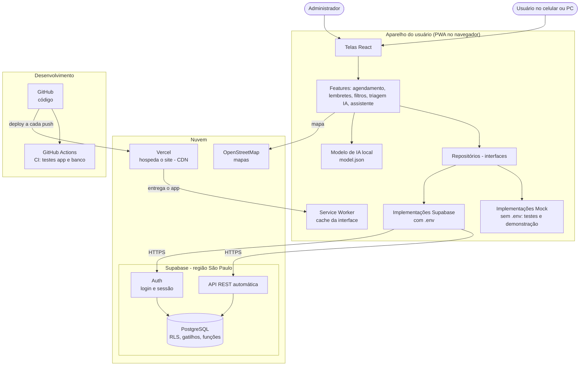
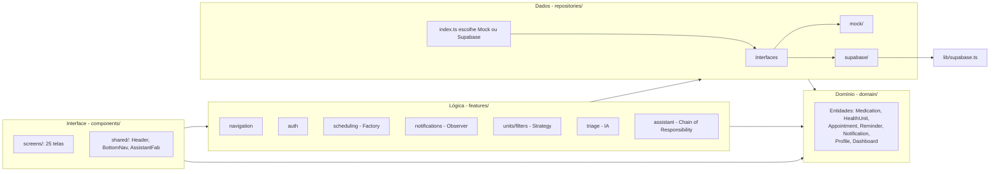
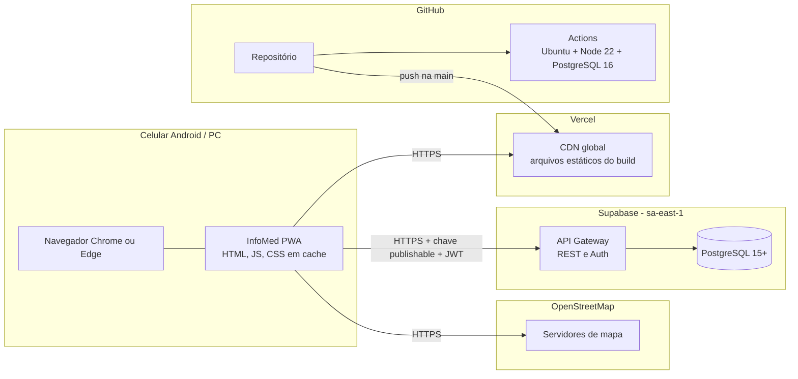

# Arquitetura

## Visão geral

## Camadas do front-end

| Camada | Pasta | Responsabilidade |
|---|---|---|
| Interface | `src/app/components` | Telas e componentes visuais |
| Lógica/Features | `src/app/features` | Regras de cada funcionalidade e os padrões de projeto |
| Domínio | `src/app/domain` | Entidades e tipos do negócio |
| Repositórios | `src/app/repositories` | Contratos e implementações de acesso a dados (Mock e Supabase) |
| Infraestrutura | `src/app/lib` | Conexão com o Supabase |

## Implantação (onde cada parte roda)

