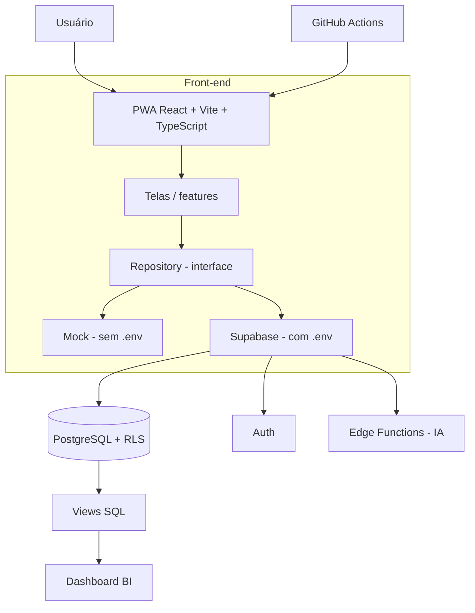

# Arquitetura (visão geral)

## Camadas do front-end

| Camada | Pasta | Responsabilidade |
|---|---|---|
| Interface | `src/app/components` | Telas e componentes visuais |
| Domínio | `src/app/domain` | Entidades e tipos (ex.: `Medication`) |
| Repositórios | `src/app/repositories` | Contratos e implementações de acesso a dados |
| Infraestrutura | `src/app/lib` | Conexão com serviços externos (Supabase) |
| Estado/Features | `src/app/features` | Estado compartilhado e lógica de cada funcionalidade (ex.: autenticação) |
