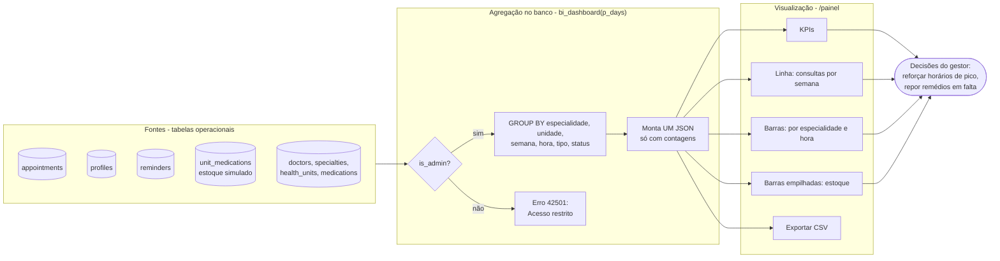
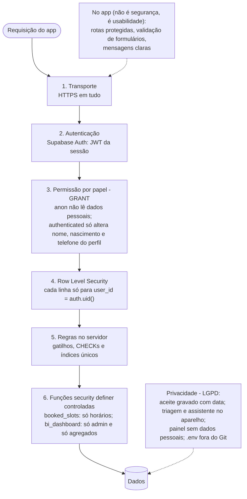
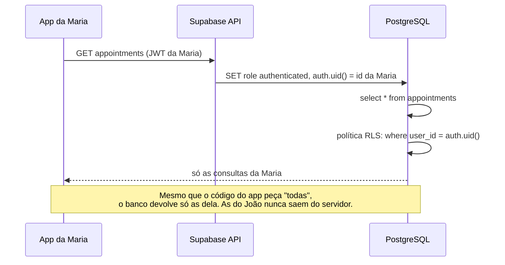
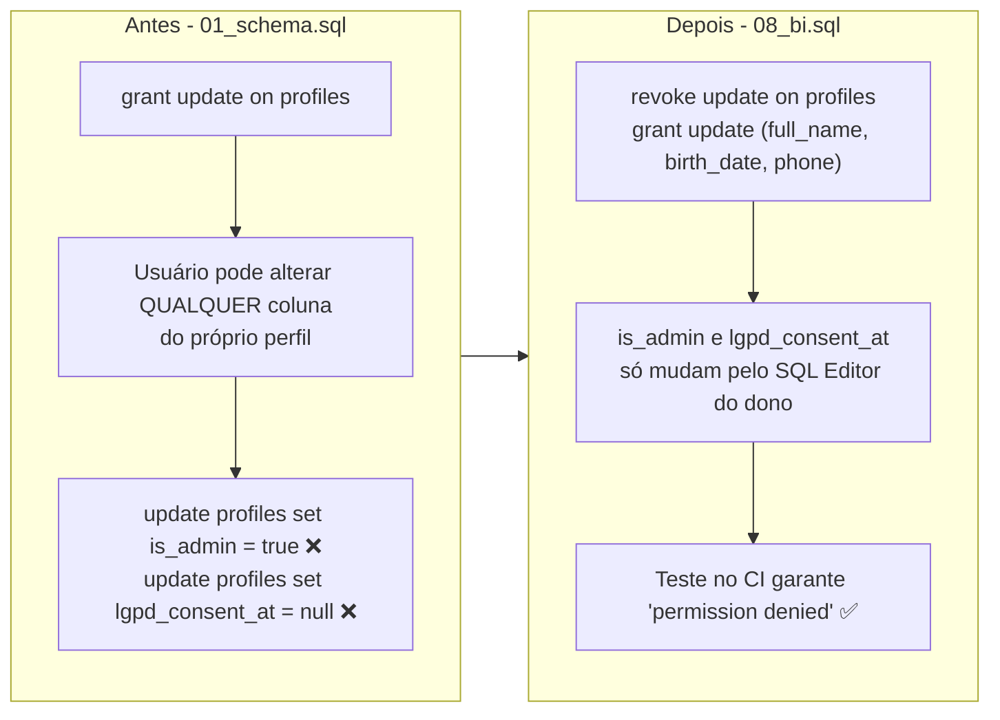

# Business Intelligence e segurança

## Fluxo de dados do painel de BI (ADR-015)

## Camadas de segurança (defesa em profundidade)

## Como o RLS decide (exemplo: listar consultas)

## Correção de escalada de privilégio (db/08_bi.sql)

