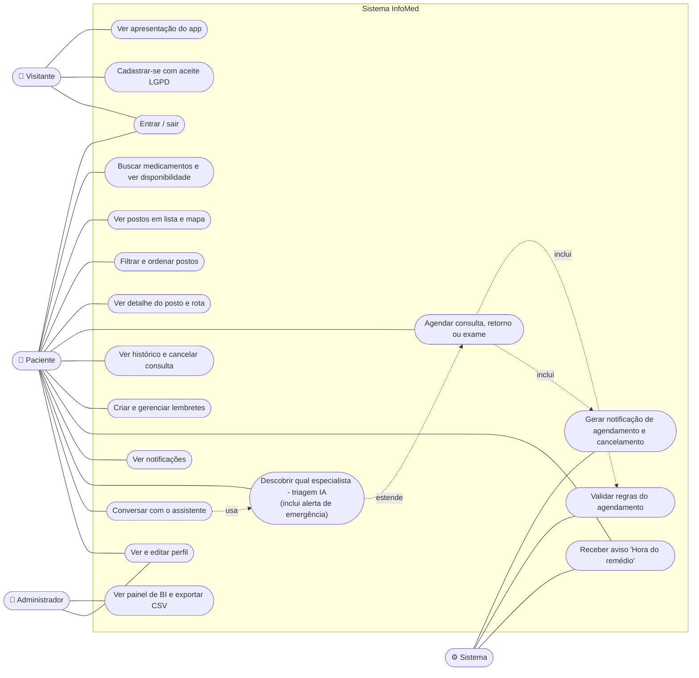

# Casos de uso

Atores: **Visitante** (não logado), **Paciente** (usuário logado), **Administrador** (gestor, promovido manualmente no banco) e o **Sistema** (gatilhos do banco e agendador de lembretes).

O Mermaid não tem o diagrama de casos de uso da UML; este é o equivalente com atores à esquerda e casos de uso (formas arredondadas) dentro do limite do sistema.

> O Administrador também é um Paciente (herda todos os casos de uso do Paciente); no diagrama aparecem só os casos exclusivos dele para não poluir.

## Lista dos casos de uso

| # | Caso de uso | Ator | Tela | Ficha |
|---|---|---|---|---|
| UC1 | Ver apresentação do app | Visitante | `/`, `/onboarding/1..3` | — |
| UC2 | Cadastrar-se com aceite LGPD | Visitante | `/cadastro` | F04 |
| UC3 | Entrar / sair | Visitante, Paciente | `/entrar`, Perfil | F04 |
| UC4 | Buscar medicamentos e ver disponibilidade | Paciente | `/medicamentos` | F01 |
| UC5 | Ver postos em lista e mapa | Paciente | `/postos` | F06 |
| UC6 | Filtrar e ordenar postos | Paciente | `/postos/filtros` | F10 |
| UC7 | Ver detalhe do posto e rota | Paciente | `/postos/:id` | F06 |
| UC8 | Agendar consulta, retorno ou exame | Paciente | `/agendar...` | F08 |
| UC9 | Ver histórico e cancelar | Paciente | `/historico` | F08 |
| UC10 | Criar e gerenciar lembretes | Paciente | `/lembretes` | F09 |
| UC11 | Receber aviso "Hora do remédio" | Paciente, Sistema | qualquer tela | F09 |
| UC12 | Ver notificações | Paciente | `/notificacoes` | F09 |
| UC13 | Descobrir qual especialista (triagem IA) | Paciente | `/triagem` | F12 |
| UC14 | Conversar com o assistente | Paciente | `/assistente` | F14 |
| UC15 | Ver e editar perfil | Paciente | `/perfil` | F13 |
| UC16 | Ver painel de BI e exportar CSV | Administrador | `/painel` | F13 |
| UC17 | Gerar notificações automáticas | Sistema (gatilho do banco) | — | F08 |
| UC18 | Validar regras do agendamento | Sistema (gatilho do banco) | — | F08 |
