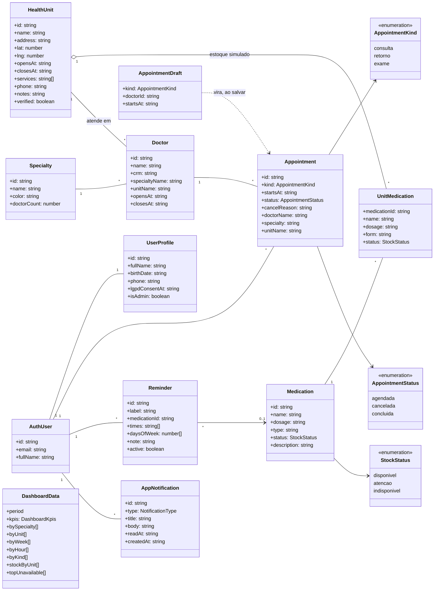

# Diagrama de classes do domínio

Entidades em `src/app/domain/` e os repositórios que as fornecem (`src/app/repositories/`). Cada repositório tem uma implementação Mock e uma Supabase (padrão Repository, ADR-003).

## Repositórios (interfaces)

```mermaid
classDiagram
  direction TB
  class MedicationRepository {
    <<interface>>
    +list(query) Medication[]
    +getById(id) Medication
  }
  class HealthUnitRepository {
    <<interface>>
    +list() HealthUnit[]
    +getById(id) HealthUnit
    +listMedications(unitId) UnitMedication[]
    +unitIdsWithMedication(medicationId) string[]
  }
  class AppointmentRepository {
    <<interface>>
    +listSpecialties() Specialty[]
    +listDoctors(specialtyId) Doctor[]
    +bookedSlots(doctorId, from, to) string[]
    +create(draft) Appointment
    +listMine() Appointment[]
    +cancel(id, reason)
  }
  class ReminderRepository {
    <<interface>>
    +list() Reminder[]
    +create(input) Reminder
    +setActive(id, active)
    +remove(id)
  }
  class NotificationRepository {
    <<interface>>
    +list() AppNotification[]
    +countUnread() number
    +markRead(id)
    +markAllRead()
  }
  class AuthRepository {
    <<interface>>
    +getCurrentUser() AuthUser
    +signUp(input) SignUpResult
    +signIn(email, password) AuthUser
    +signOut()
    +onAuthChange(callback)
  }
  class ProfileRepository {
    <<interface>>
    +getMine() UserProfile
    +updateMine(input) UserProfile
  }
  class AnalyticsRepository {
    <<interface>>
    +getDashboard(days) DashboardData
  }
  class index_ts["repositories/index.ts"] {
    escolhe Mock ou Supabase
  }
  index_ts ..> MedicationRepository
  index_ts ..> HealthUnitRepository
  index_ts ..> AppointmentRepository
  index_ts ..> ReminderRepository
  index_ts ..> NotificationRepository
  index_ts ..> AuthRepository
  index_ts ..> ProfileRepository
  index_ts ..> AnalyticsRepository
```

