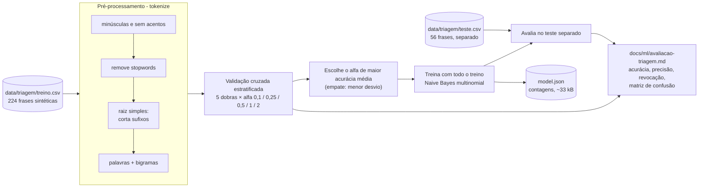
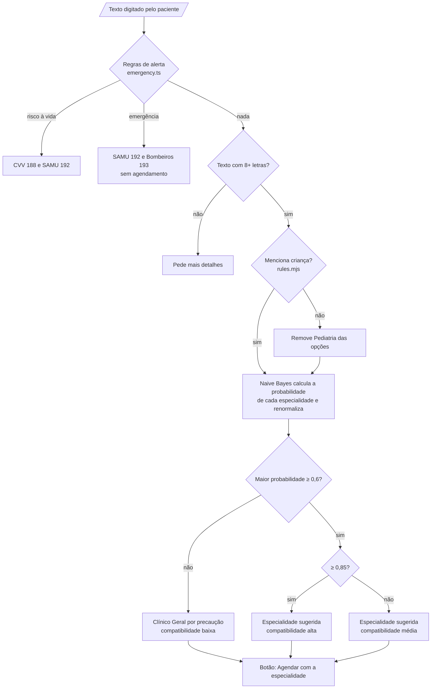
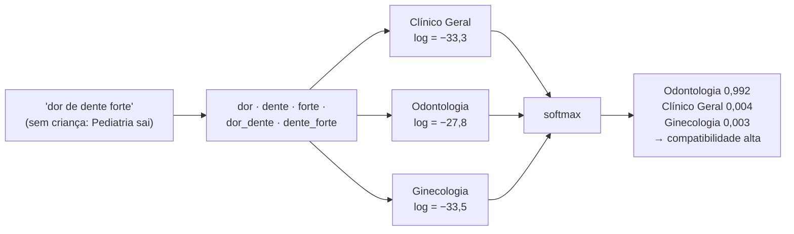

# IA: triagem por sintomas (ADR-014)

## Pipeline de treino (feito no computador, por script)

## Uso no app (no aparelho, a cada pergunta)

## Como o Naive Bayes decide (fórmula)

Para cada especialidade *c* e as palavras *w* do texto:

`pontuação(c) = log P(c) + Σ log [ (contagem(w, c) + α) / (total de palavras de c + α · tamanho do vocabulário) ]`

A especialidade com maior pontuação vence; as pontuações são convertidas em probabilidades (softmax) para aplicar o limiar de 0,6.

> Valores reais calculados com o `model.json` atual (alfa = 1). Se o modelo for retreinado com outros dados, eles mudam.
