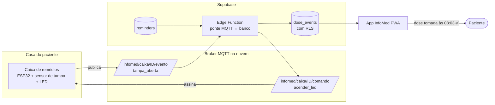
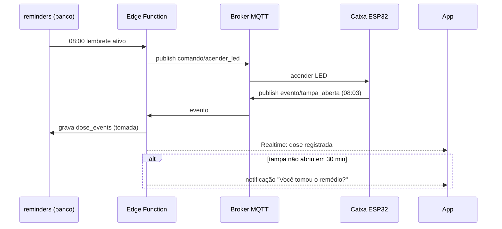

# Proposta de IoT: caixa de remédios inteligente (NÃO IMPLEMENTADA)

> **Atenção:** este diagrama é uma **proposta de trabalho futuro** para a disciplina de Sistemas Distribuídos Aplicados a IoT. Nada disto existe no código hoje. No TCC, apresentar como proposta.

**Ideia:** uma caixa de remédios com sensor de tampa (aberta/fechada) e um microcontrolador com Wi-Fi (ex.: ESP32). Quando o horário do lembrete chega, a caixa acende um LED; quando a pessoa abre a tampa, a caixa avisa o sistema que a dose foi tomada. Se a tampa não for aberta em 30 minutos, o app avisa a pessoa (ou um familiar).

## Arquitetura proposta

## Sequência proposta

## Por que é um sistema distribuído

- Vários nós independentes (caixa, broker, nuvem, app) comunicando por mensagens.
- Padrão publicar/assinar (MQTT), o mesmo princípio do Observer já usado no app (ADR-012), só que entre máquinas.
- Tolerância a falhas: a caixa guarda eventos se ficar sem Wi-Fi e envia depois.
- Para o TCC sem hardware: a caixa pode ser **simulada** por um script que publica no broker.
