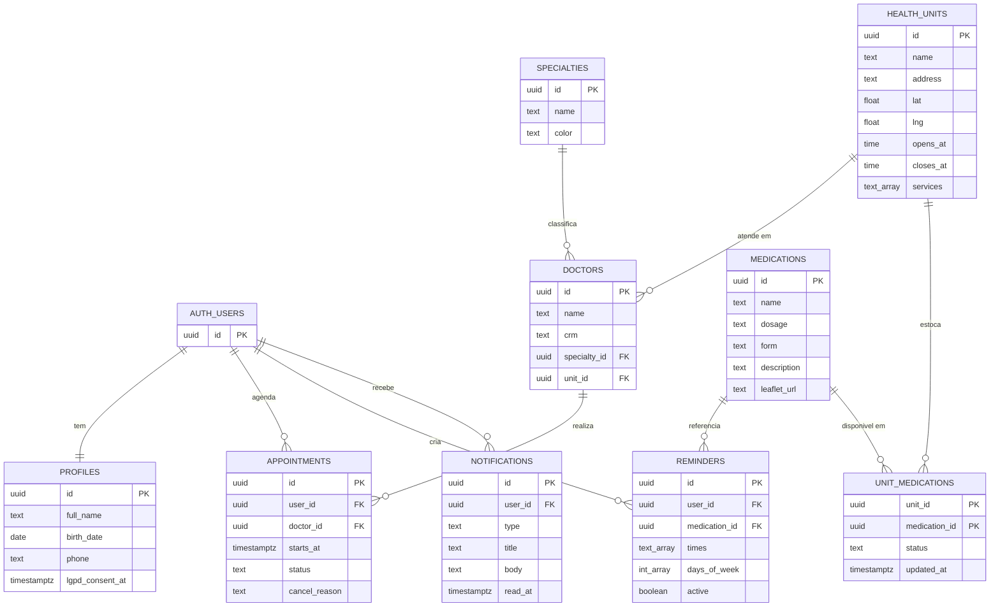

# Modelo de dados (ER)

## Regras de acesso por tabela

| Tabela | Leitura | Escrita |
|---|---|---|
| medications, health_units, unit_medications, specialties, doctors | Pública | Somente administrador (painel) |
| profiles | Somente o próprio usuário | O próprio usuário (atualização); criação automática por gatilho no cadastro |
| appointments | Somente o próprio usuário | O próprio usuário (inserir e atualizar; sem exclusão) |
| reminders | Somente o próprio usuário | O próprio usuário (inserir, atualizar e excluir) |
| notifications | Somente o próprio usuário | O usuário marca como lida; criação feita pelo servidor |

## Objetos auxiliares

- **View `medications_with_status`**: status agregado do medicamento (disponível, estoque baixo ou indisponível) calculado a partir do estoque por unidade.
- **Função `booked_slots(doctor, de, até)`**: devolve os horários já ocupados de um médico sem expor dados de outros usuários.
- **Gatilho `on_auth_user_created`**: cria o perfil automaticamente quando um usuário se cadastra.
