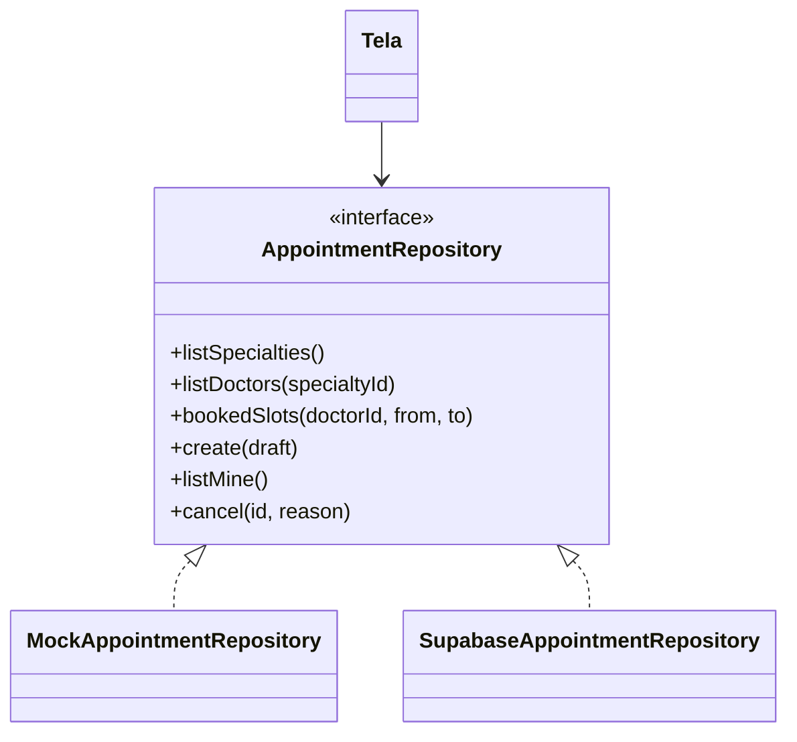
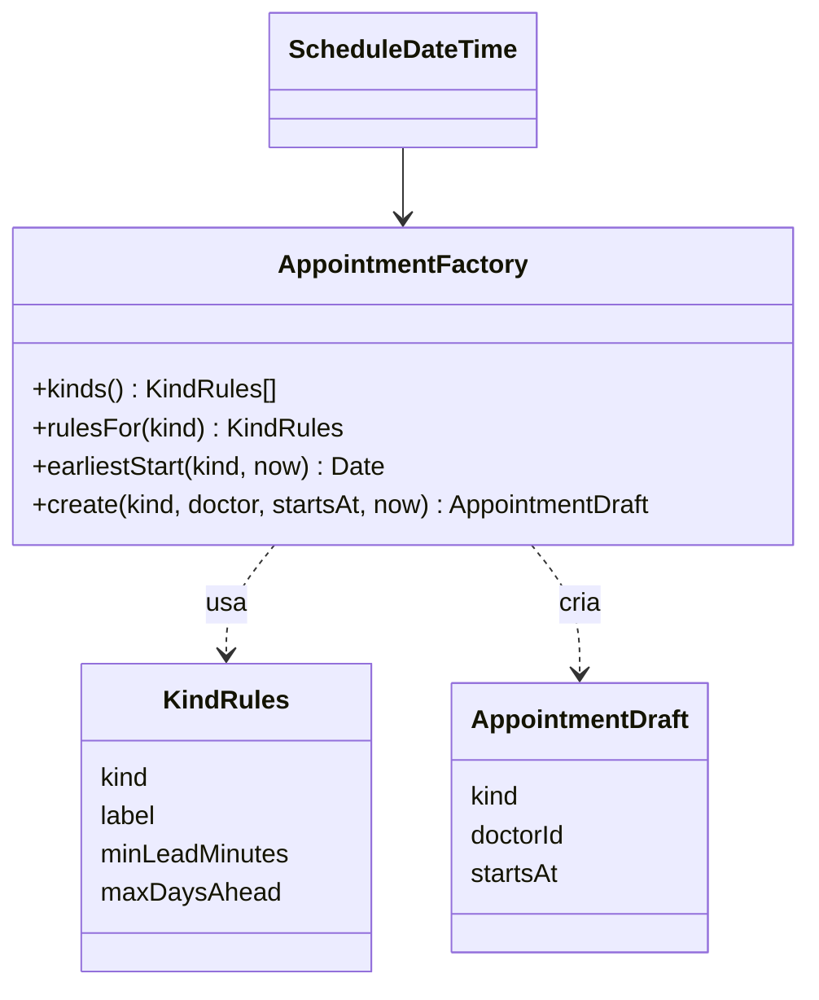
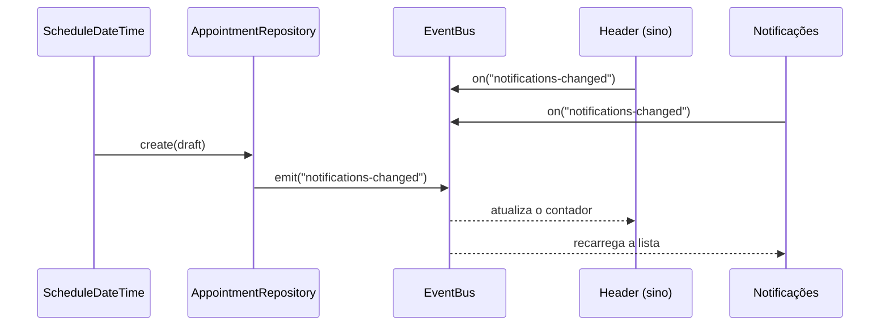
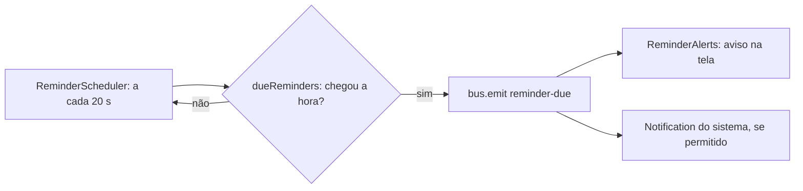

# Padrões de projeto aplicados

## Repository (ADR-003)

O mesmo desenho vale para `MedicationRepository`, `HealthUnitRepository`, `AuthRepository`, `NotificationRepository` e `ReminderRepository`.

## Factory (ADR-011)

## Observer (ADR-012)

## Strategy (planejado, T9)

Filtros dos postos (por distância, serviço, aberto agora e estoque) como estratégias intercambiáveis.
