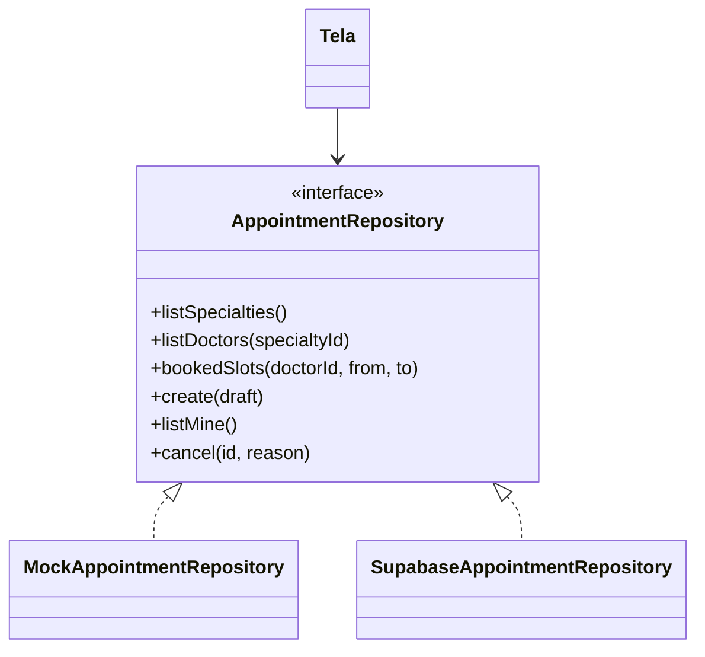
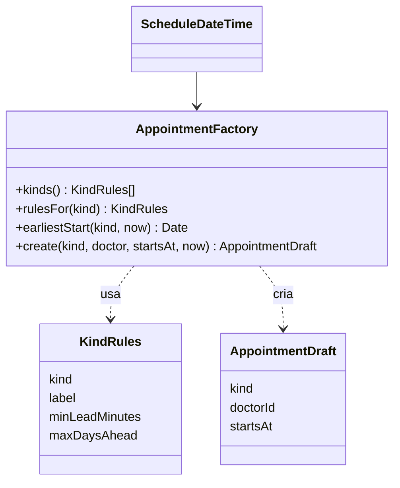
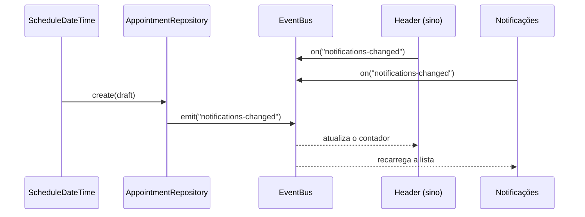
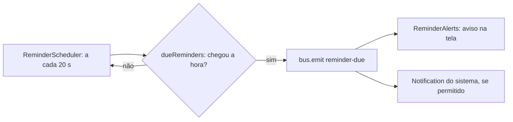
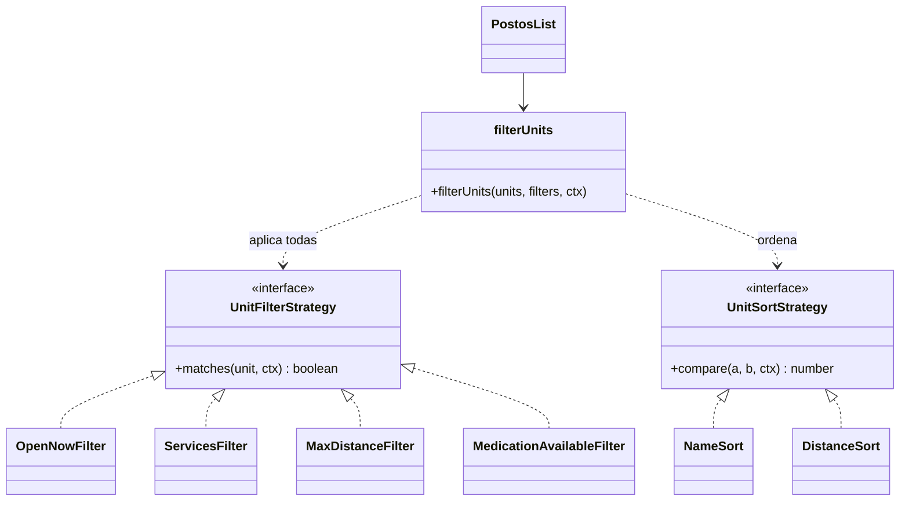
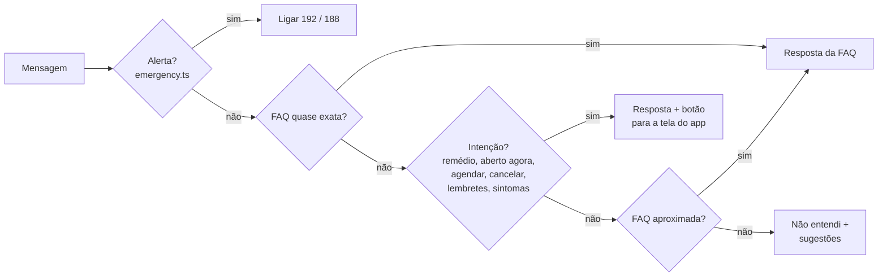
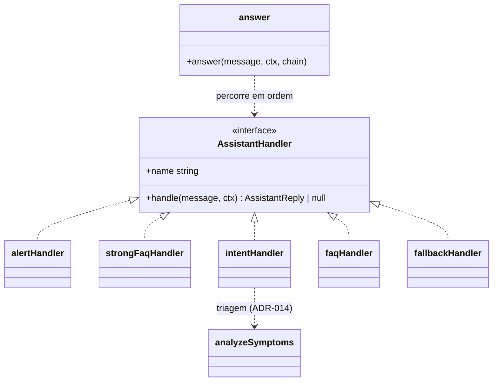

# Padrões de projeto aplicados

## Repository (ADR-003)

O mesmo desenho vale para `MedicationRepository`, `HealthUnitRepository`, `AuthRepository`, `NotificationRepository` e `ReminderRepository`.

## Factory (ADR-011)

## Observer (ADR-012)

## Strategy (ADR-013)

## Chain of Responsibility: assistente (ADR-016)

Cada elo tenta responder; se devolver `null`, a mensagem passa para o próximo. O alerta vem sempre primeiro.

