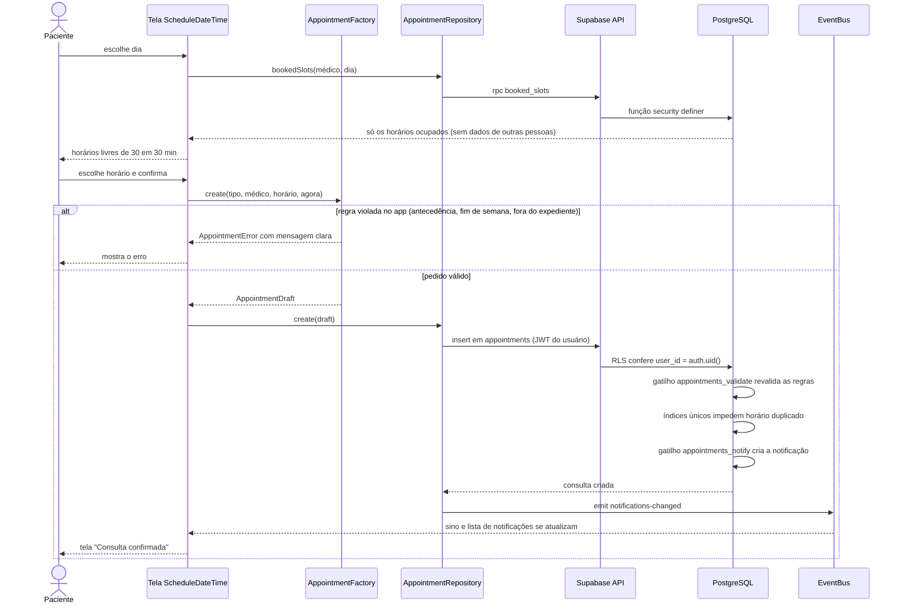
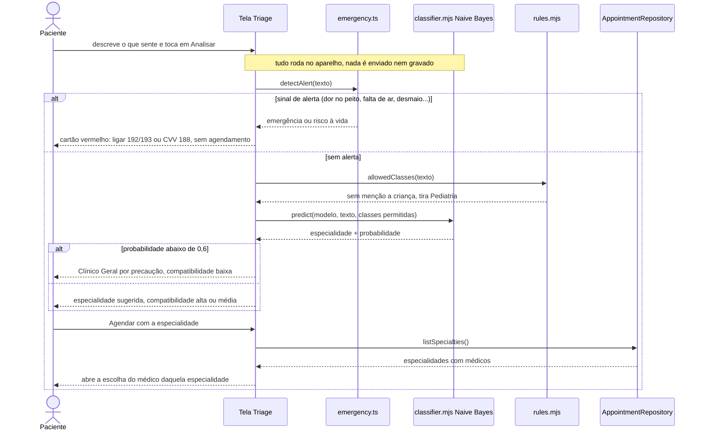
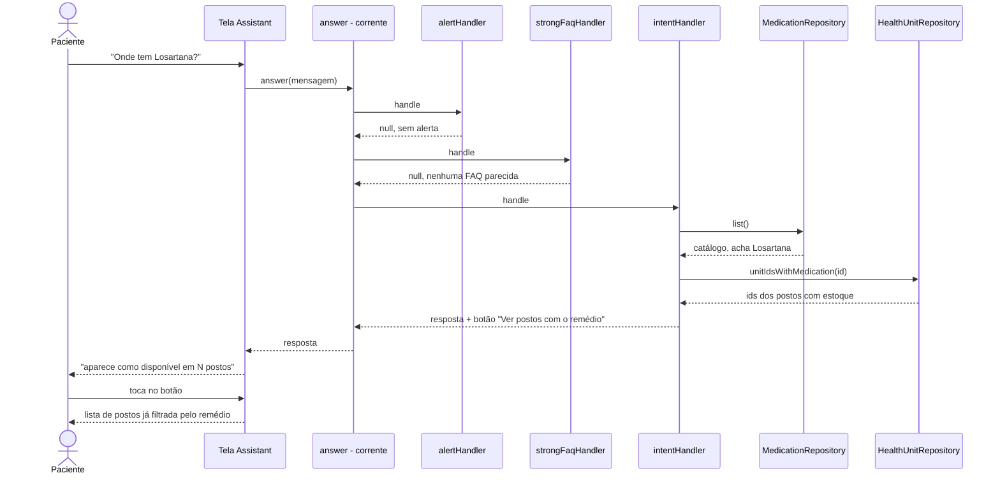
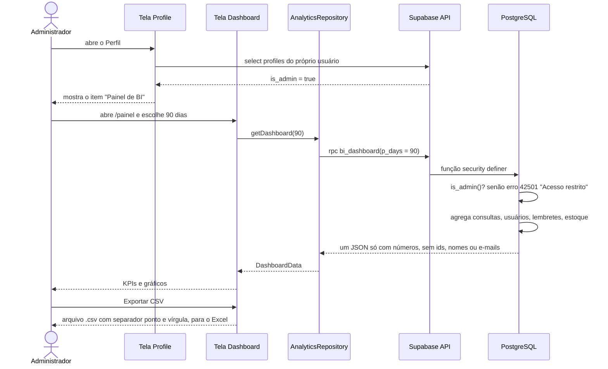
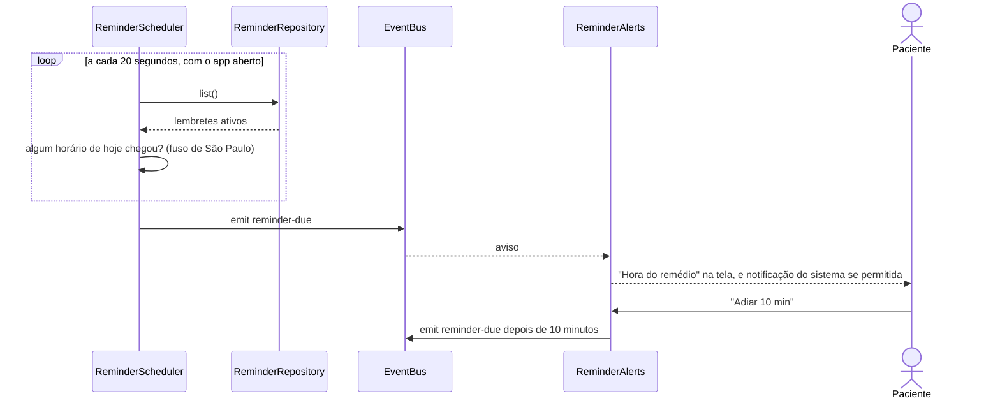

# Diagramas de sequência

## 1. Agendar uma consulta (Factory + regras no banco + notificação)

## 2. Triagem por IA (sintoma para especialidade)

## 3. Assistente: "Onde tem Losartana?"

## 4. Painel de BI (só administrador)

## 5. Aviso "Hora do remédio" (Observer)

## 6. Cadastro com consentimento LGPD

Ver `fluxo-autenticacao.md`.
